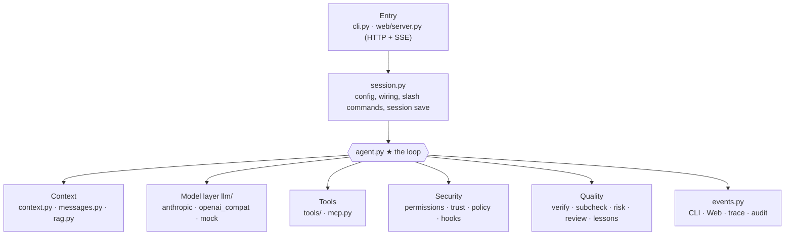
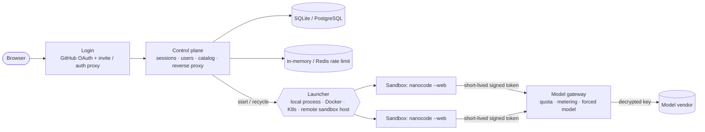

<div align="center">

# nanocode

**A mini coding Agent built to help you understand Agent architecture and how Claude Code works under the hood**

Pure Python stdlib · Zero dependencies · Every file has explanatory comments · Runs without any API key


[30-second quickstart](#30-second-quickstart-no-api-key-needed) ·
[Screenshots](#screenshots) ·
[Architecture](#architecture) ·
[How to learn](#how-to-learn) ·
[Multi-user deployment](server/README.md) ·
[Docs index (Chinese)](docs/README.md) ·
[Changelog (Chinese)](CHANGELOG.md) ·
[Development journey](docs/journey.md) ·
[Resume-ready](docs/resume.md)

[中文](README.md) | **English**


</div>

## Highlights

- **Pure Python stdlib**, zero dependencies, ~6,200 lines of core code (with extensive Chinese comments); every file starts with an explanation
- **380+ unit tests** covering every branch of the loop, streaming parsing for both protocols, the retrieval pipeline, security regressions, eval framework self-check, and a test that keeps docs and code in sync
- **Works with any model**: Claude, GPT, DeepSeek, Qwen, Kimi, Zhipu GLM, SiliconFlow, OpenRouter, local Ollama, or any OpenAI / Anthropic-compatible proxy
- **Implements Claude Code's core mechanics**: Agent loop, streaming output, file/shell/search/web tools, permission modes and rules, hooks, project memory, context compaction, todos, sub-agents, Skills, custom slash commands, MCP, session persistence
- **Check → correct → review closed loop**: auto-verify (run checks after edits, loop back on failure), sub-agent acceptance (system-generated report, not self-reported), review mode (auto-allow safe steps, always confirm high-risk, summarize diff at end), lessons learned (rejected causes written to project memory after your confirmation). See [Chapter 11](docs/11-verification-loop.md)
- **Built-in Web debug panel**: watch each loop iteration, the full context sent to the model, system prompt, tool definitions, installed MCP servers and skills in real time
- **Built-in mock model**: run the entire flow without an API key to see how it works
- **Small but complete RAG**: chunking, Chinese BM25, optional vector retrieval, RRF hybrid, incremental index, plus an eval script comparing grep vs retrieval
- **Agent task eval**: 13 coding tasks with hidden tests, measuring success rate, steps, and tokens for comparing models and changes
- **Multi-user deployment platform** ([server/](server/README.md)): control plane + model gateway + per-session sandboxes designed for thousands of users; PostgreSQL / Redis / Docker / K8s used when available, runs on a single machine otherwise
- **440+ automated tests**: 370+ core, 70+ platform, covering the loop, streaming parsing, retrieval, security regressions, and eval self-check

> nanocode is a from-scratch teaching implementation based on Claude Code's public docs and observable behavior. It does not contain and is not derived from Claude Code source. It aims to *explain the principles clearly*, not to match feature parity.

## Try it online

A hosted multi-user instance is available at **<https://nanocode.aipulse.lol>**: sign in with GitHub, registration needs an invite code (ask the admin), and you bring your own LLM API key (stored encrypted, used only by the platform's model gateway, never inside the sandbox). The built-in demo model works without a key. Screenshots of the platform are in the [Chinese README](README.md#在线使用).

## Screenshots

<table>
<tr>
<td width="50%"><b>CLI: edit code and run tests with a real model</b><br></td>
<td width="50%"><b>Context: everything the model "remembers"</b><br></td>
</tr>
<tr>
<td><b>Extensions: MCP servers, skills, custom commands</b><br></td>
<td><b>Architecture learning page: watch messages grow step by step</b><br></td>
</tr>
<tr>
<td><b>Multi-user platform: sessions, model switching, approvals</b><br></td>
<td><b>Multi-user platform: model and API key management</b><br></td>
</tr>
</table>

## Architecture

### How one request flows

```mermaid
flowchart LR
    U([User]) -->|CLI / Web| S[Session<br/>wires everything together]
    S --> A{{Agent loop<br/>agent.py}}
    A -->|system + messages + tools| P[Provider<br/>Anthropic / OpenAI-compatible]
    P -->|text + tool_use| A
    A -->|each tool call| G[Permission check<br/>mode · allow/deny · hooks]
    G -->|allowed| T[Tools<br/>file · bash · search · web · sub-agent · skill · MCP]
    G -.->|needs confirmation| U
    T -->|tool_result| A
    A -->|no more tool calls| V[Auto-verify (optional)<br/>verify.py]
    V -->|failed: loop back with output| A
    V -->|passed| U
    A -.->|events| E[(Event bus<br/>CLI · Web · trace · audit)]
```

The loop itself is only a few dozen lines: call the model → if it asks for a tool, execute it and append the result to messages → call the model again, until it stops asking for tools. Everything else is built around this loop:



### Multi-user deployment (thousand-user scale)



One sandbox per session. User API keys are encrypted at rest and decrypted only in the gateway; **sandboxes never see real keys**. Docker / K8s sandboxes have no outbound internet and can only reach the gateway. Design in [Chapter 12](docs/12-distributed-deployment.md); code and runbook in [server/README.md](server/README.md). Deployment topologies, the full `NCS_*` reference, login / invites / admin and the security model are in [docs/](docs/README.md) (Chinese).

---

## 30-second quickstart (no API key needed)

```bash
cd nanocode
python3 -m nanocode --web          # open http://127.0.0.1:8765
# or terminal UI
python3 -m nanocode
```

Default uses the mock model. Type any message and it will walk through a full Agent loop: list todos → inspect directory → write file (asks permission) → run (asks permission) → summarize. In the Web UI, switch to "Loop timeline" and "Context" on the right to watch messages grow each iteration.

To install as a command: `pip install -e .`, then use `nanocode` directly. Requires Python ≥ 3.10.

### Want the bare skeleton? `examples/minimal_agent.py`

The framework layers on permissions, hooks, context compression, sub-agents, and more. `examples/minimal_agent.py` strips all of that away, leaving the essence of an Agent in **~260 lines with zero third-party dependencies**:

```
while the model still wants tools:
    run the tool, append the result to the conversation
otherwise return the final answer
```

It ships `list_dir` / `read_file` / `bash` and talks to any OpenAI-compatible endpoint:

```bash
python3 examples/minimal_agent.py --mock "list the current directory"   # offline loop demo
python3 examples/minimal_agent.py --base-url https://api.deepseek.com/v1 \
    --model deepseek-chat "count the lines in README.md"
```

Read it alongside [Chapter 01](docs/01-agent-loop.md): understand this file first, then see what engineering `nanocode/agent.py` adds on top.

## Connect a real model

| Vendor | Command | API key env var |
|---|---|---|
| Anthropic Claude | `nanocode --provider anthropic --model claude-sonnet-5-5` | `ANTHROPIC_API_KEY` |
| OpenAI | `nanocode --provider openai --model <model>` | `OPENAI_API_KEY` |
| DeepSeek | `nanocode --provider deepseek --model deepseek-chat` | `DEEPSEEK_API_KEY` |
| Qwen (Alibaba) | `nanocode --provider qwen --model qwen-plus` | `DASHSCOPE_API_KEY` |
| Kimi (Moonshot) | `nanocode --provider kimi --model <model>` | `MOONSHOT_API_KEY` |
| Zhipu GLM | `nanocode --provider glm --model <model>` | `ZHIPUAI_API_KEY` |
| SiliconFlow | `nanocode --provider siliconflow --model <model>` | `SILICONFLOW_API_KEY` |
| OpenRouter | `nanocode --provider openrouter --model <model>` | `OPENROUTER_API_KEY` |
| Local Ollama | `nanocode --provider ollama --model qwen2.5-coder` | none |
| Any compatible endpoint | `nanocode --provider custom --protocol openai --base-url https://xxx/v1 --model <model>` | `NANOCODE_API_KEY` |

Model names change frequently; refer to each vendor's docs. You can also set config via env vars (`NANOCODE_PROVIDER`, `NANOCODE_MODEL`, `NANOCODE_BASE_URL`, `NANOCODE_API_KEY`) or `.nanocode/settings.json`. Note: bash / verify / hook subprocesses run by the agent do not see `NANOCODE_*` variables (including `NANOCODE_API_KEY`); vendor keys such as `OPENAI_API_KEY` still pass through in local mode, see `NANOCODE_TOOL_ENV_KEEP` below.

**Model selection note**: Agents depend heavily on tool-calling ability. Small models (especially local 7B and below) often fail to call tools or format parameters incorrectly — you'll see lots of errors in the debug panel. That itself is useful learning material.

## Common operations

```bash
nanocode -p "explain main.py"                 # one-shot mode, exits after (great for scripts, CI)
nanocode --mode plan                           # read-only planning: inspect only, no edits
nanocode --mode accept_edits                   # auto-allow file edits, commands still ask
nanocode --mode review                         # review mode: tests and in-project edits auto-allowed, high-risk always confirmed, diff summarized at end
nanocode --trace                              # log all events to ~/.nanocode/projects/<project>/traces/
nanocode --trust                              # trust this project's config (hooks, MCP, allow rules, see Security below)
nanocode --resume                             # resume the previous session
nanocode --verify "pytest -q"                 # auto-verify: run this before ending; loop back on failure
nanocode --cwd ~/projects/app                 # set working directory (default: current dir)
nanocode --api-key sk-xxx                     # pass API key directly (prefer env var; CLI stays in shell history)
```

### Auto-verify: let the Agent self-check after edits

The model saying "done" isn't enough. After you configure a check command, whenever the Agent has made changes this round (wrote files, ran bash, etc.) it runs the check before ending:

- Pass → end normally;
- Fail → feed the last 4000 chars of output back to the model to fix, up to `max_retries` (default 3);
- Exceed retries, or **same error twice in a row** (no progress) → stop and attach the last failure to the response. In one-shot mode (`-p`) the exit code is 1, so scripts and CI can detect it.

```jsonc
// .nanocode/settings.json (or ~/.nanocode/settings.json)
"verify": "pytest -q"
"verify": {"command": "pytest -q", "max_retries": 3, "timeout": 300}
```

Read-only investigation and pure Q&A don't trigger the check. Project-provided verify requires trusting the project (same as hooks); `--verify` on the CLI takes effect immediately. Each check emits a `verify` event visible in CLI and Web panel. It only applies to the main Agent; you are responsible for the check itself (weak tests passing doesn't mean correct).

### Review mode: fewer prompts, but high-risk always asks

`default` asks for everything, and people habitually click "allow". The only way to reduce prompts is `bash(*)` in allow, but that allows `rm -rf` with zero confirmation. `--mode review` adds a middle tier:

- **Auto-allow**: read in-project files, edit in-project files, whitelisted check commands (`pytest`, `unittest`, `mypy`, `ruff check`, `cargo test`, `go test`, `npm test`, `make test`, read-only `git status/diff/log/show`, `ls/cat/grep`, and no `; & | $ >` shell metacharacters).
- **Ask**: anything unrecognized (fail-safe: ask more, never skip).
- **Always confirm**: deletes, `git push / reset --hard`, privilege escalation, permission changes, installing deps, writing outside the project, writing `.env` / `.git/` / secret files. **No "always allow" regardless of allow rules.**
- **End-of-run summary**: list changed files and diff plus auto-verify results; commit/push still require your confirmation.

Limitation: these are heuristic rules, not a sandbox. **Check commands execute project code, including code the Agent just wrote**; the summary is post-hoc and can't roll back. Use a container or VM for strong isolation.

### Sub-agent acceptance and lessons learned

- **Sub-agent acceptance**: sub-agent conclusions always include a **system-generated** acceptance report (which files changed, whether it stayed in bounds, whether checks passed; "unverified" if no check configured). The `task` tool accepts `check` (command, subject to permissions) and `allowed_paths` (modification scope).
- **Lessons learned**: rounds rejected by auto-verify then fixed generate a candidate constraint (verbatim from the failure output, not model-summarized). Use `/memory accept [id|all]` to write it into the project's `NANOCODE.md`, or `/memory reject` to discard.

Principles, limitations, and how to measure whether they help: see [Chapter 11](docs/11-verification-loop.md).

### Slash commands

Type in interactive mode (also works in the Web input box):

| Command | Effect |
|---|---|
| `/help` | show help |
| `/clear` | clear conversation, start a new task |
| `/compact [focus]` | manually compact context |
| `/context` | view context usage |
| `/cost` | view token usage |
| `/mode [mode]` | view / switch permission mode: `default` `accept_edits` `plan` `review` `bypass` |
| `/tools` | list available tools |
| `/todos` | view todo list |
| `/memory [accept\|reject [id\|all]]` | view loaded `NANOCODE.md` and pending lesson candidates; accept / reject |
| `/init` | have the Agent analyze the project and generate `NANOCODE.md` |
| `/resume` | resume the previous session |
| `/providers` | list built-in vendor presets |
| `/mcp` | view MCP server connection status (list tools on success; show reason and server stderr on failure), see Chapter 07 |
| `/skills` | view installed skills and custom commands, and whether they come from user or project dir |
| `# one-liner` | append a one-liner to project `NANOCODE.md` (memory) |
| `/your-command` | custom commands from `.nanocode/commands/*.md`, see Chapter 06 |

`Ctrl-C` interrupts the current task.

## Configuration reference

Precedence: `~/.nanocode/settings.json` (yours, always on) → project `.nanocode/settings.json` → `.nanocode/settings.local.json`; later wins, lists and dicts merge. **Project settings marked "requires trust" don't take effect until you confirm trust for the project** (see Security below).

| Setting | Description | In project config |
|---|---|---|
| `"provider"` `"model"` `"base_url"` `"protocol"` `"headers"` | which model, how to connect | `provider` `base_url` `protocol` `headers` require trust (API key goes there) |
| `"mode"` | permission mode: `default` `accept_edits` `plan` `review` `bypass` | requires trust |
| `"permissions"` | `{"allow": [...], "deny": [...], "sensitive_read": [...], "sensitive_read_exclude": [...]}`: rules like `"bash(git status*)"`; `sensitive_read` adds sensitive-file patterns that need confirmation to read, `sensitive_read_exclude` removes default ones (see [chapter 4](docs/04-permissions-and-hooks.md)) | `allow` and `sensitive_read_exclude` require trust; `deny` and `sensitive_read` always active |
| `"hooks"` | lifecycle hooks, see Chapter 04 | requires trust |
| `"mcpServers"` | MCP servers, see Chapter 07 | requires trust |
| `"verify"` | auto-verify command, string or `{"command": ..., "max_retries": 3, "timeout": 300}` | requires trust |
| `"max_tokens"` `"context_window"` | max output tokens; context window size (drives when to auto-compact) | always active |
| `"rag"` | document retrieval config, see Chapter 10 | `rag.embedding` requires trust |
| `"suggest_memory"` | set `false` to disable lesson candidate prompts (default on) | always active |

Environment variables:

| Variable | Description |
|---|---|
| `NANOCODE_PROVIDER` `NANOCODE_MODEL` `NANOCODE_BASE_URL` `NANOCODE_API_KEY` | same as `--provider` etc.; per-vendor key vars in the table above |
| `NANOCODE_HOME` | user dir (personal config, memory, trust records, sessions), default `~/.nanocode` |
| `NANOCODE_PERMISSION_TIMEOUT` | how long to wait for a permission prompt before denying, default 600s. Not currently passed into session sandboxes by `nanocode_server` |
| `NANOCODE_PUBLIC_HOST` `NANOCODE_PUBLIC_ORIGIN` | trusted external addresses when behind a reverse proxy, see Security below |
| `NANOCODE_POLICY` | platform policy file (read-only mounted by platform in multi-user deployments): locks model endpoint, restricts allowed permission modes, strips specified keys from user/project config, enables audit log; highest priority over all config and CLI args; refuses to start if unreadable. See `policy.py` and [Chapter 12](docs/12-distributed-deployment.md#nine-implementation-status) |
| `NANOCODE_WEB_TOKEN` | Web UI API token; randomly generated each start if unset; injected by control plane in multi-user deployments (min 16 chars) |
| `NANOCODE_TOOL_ENV_KEEP` | Comma-separated variable names to pass through to bash / verify / hook subprocesses. Those subprocesses **never** get `NANOCODE_*` / `NCS_*` (not allowable); in platform mode (`NANOCODE_WEB_TOKEN` set) they also lose vendor keys and variables ending in `_TOKEN`, `_SECRET`, `_PASSWORD`, `_API_KEY` etc. unless listed here. In local mode vendor keys are passed through as before (#134) |
| `NANOCODE_WEB_RATE_PER_MIN` `NANOCODE_WEB_RATE_BURST` | `/api/chat` rate limit by client IP (token bucket): refill 10/min, burst 5 (default). `#` memory and model-free `/commands` don't count; exceeded returns 429 + `Retry-After`. Set `0` to disable |
| `NANOCODE_WEB_MAX_QUEUE` | max queued messages while Agent is busy, default 3; full returns 429 (`code: queue_full`). "Stop" also clears the queue. Set `0` for unlimited |
| `NANOCODE_WEB_DAILY_RUNS` | max Agent runs per calendar day (including queued), default 200; exhausted returns 429 (`code: daily_budget`). Set `0` for unlimited |
| `NANOCODE_WEB_DAILY_LLM_CALLS` | max model API calls per calendar day (Provider-layer count; one Agent run may call many), default `0` unlimited; on quota, treated as "exhausted" and not retried |
| `NANOCODE_TRUST_PROXY` | set `1` to use leftmost `X-Forwarded-For` for client identity. Only enable behind a real reverse proxy (otherwise spoofable); if behind a proxy and not enabled, all users share the proxy IP's rate bucket |

## Repository layout

```
nanocode/
├── messages.py        unified message format — what Agent "memory" looks like
├── llm/               model adapter layer
│   ├── base.py          Provider interface, HTTP retries, SSE parsing
│   ├── openai_compat.py OpenAI-compatible protocol (covers most vendors globally)
│   ├── anthropic.py     Claude native protocol (with Prompt Caching)
│   ├── mock.py          offline mock model
│   └── __init__.py     vendor presets + factory
├── tools/             tools
│   ├── base.py          Tool abstraction, param validation, output truncation
│   ├── files.py        read_file / write_file / edit_file
│   ├── shell.py         bash
│   ├── search.py        glob / grep
│   ├── rag_tool.py      search_docs (semantic doc search)
│   ├── web.py           web_fetch (read web: confirm each time, reject localhost and internal addresses)
│   └── planning.py      todo_write / task (sub-agent) / skill
├── agent.py           ★ core loop
├── rag.py             RAG: chunking, BM25, vectors, hybrid, incremental index
├── permissions.py     permission modes and rules (paths resolved via realpath; bash compound commands split per segment)
├── trust.py           workspace trust: untrusted project config doesn't take effect without consent
├── policy.py          platform policy: read-only mount in multi-user deployments, overrides user and project config
├── hooks.py           lifecycle hooks
├── proc.py            cross-platform subprocess: spawn, kill whole tree (no killpg on Windows)
├── verify.py          auto-verify: run checks after edits, loop back on failure
├── subcheck.py        sub-agent acceptance: modification scope, file snapshot, system-generated report
├── risk.py            review-mode risk classification: whitelist auto-allow, high-risk always confirm
├── review.py          review-mode summary: changed files and diff
├── lessons.py         lessons learned: generate candidate constraints from failed check output
├── context.py         system prompt, project memory, skill/command discovery, context compaction
├── mcp.py             MCP client (stdio)
├── events.py          event bus + trace + audit log
├── session.py         wiring, slash commands, session save (auto-saved each step)
├── cli.py             terminal UI
└── web/               Web UI: server.py (HTTP + SSE + security checks), limits.py (/api/chat rate limit and daily budget), static/ (debug panel + architecture learn page)
docs/                  chaptered architecture walkthrough (read in order) plus platform / deployment docs; start at docs/README.md
examples/              MCP server examples, minimal Agent (minimal_agent.py), extension examples (extensions/: 4 MCP servers + 3 skills + 1 command), RAG eval (rag_eval/)
evals/agent_tasks/     Agent task eval: 13 tasks, hidden tests, reference answers, runner
verification/          real-environment verification checklist and results (real model, browser)
server/                multi-user control plane and model gateway (separate package, see server/README.md and Chapter 12)
deploy/                sandbox and control plane images; compose/ (single-host platform), sandbox-host/ (remote sandbox host), firewall/ (host firewall scripts), k8s/ (gVisor, egress allowlist)
tests/                 unit tests
```

## How to learn

Suggested order: run it → read [docs/00-learning-path.md](docs/00-学习路线.md) → read docs chapter by chapter with the corresponding source open → do [docs/09-exercises.md](docs/09-练习.md).

| Chapter | Content |
|---|---|
| [01 Agent loop](docs/01-agent-loop.md) | an Agent is essentially a while loop |
| [02 Messages and model adapters](docs/02-messages-and-providers.md) | unified message format, how to connect any vendor, streaming output |
| [03 Tools](docs/03-tools.md) | how tools are described to the model, why edits use string replacement |
| [04 Permissions and hooks](docs/04-permissions-and-hooks.md) | seatbelt for the Agent |
| [05 Context engineering](docs/05-context-engineering.md) | system prompt, project memory, compaction, caching |
| [06 Todos, sub-agents, Skills](docs/06-subagents-todos-skills.md) | planning, division of labor, on-demand learning |
| [07 MCP](docs/07-mcp.md) | let anyone add tools to the Agent |
| [08 Mapping to Claude Code](docs/08-claude-code-mapping.md) | which module maps to which Claude Code feature, what's still missing for production |
| [09 Exercises](docs/09-练习.md) | modify code by hand, test whether you really understand |
| [10 RAG](docs/10-rag.md) | when to retrieve instead of grep, how to build the pipeline, how to eval |
| [11 Verification loop](docs/11-verification-loop.md) | check → correct → review: auto-verify, sub-agent acceptance, review mode, lessons, and how to measure whether they help |
| [12 Distributed deployment](docs/12-distributed-deployment.md) | what's missing for 1000+ users: execution isolation, multi-tenancy, externalized state, LLM gateway, phased roadmap, launch checklist |
| [13 Model's perspective](docs/13-model-perspective.md) | where Agent behavior comes from: what the model actually sees, how training shapes Agent ability, why long context fails, randomness and eval, model-layer causes of failure modes, hands-on experiments |

Development and test workflow: [what tools and commands were used, what each does, what results](docs/workflow.md)

Development journey: [how it was built, what pitfalls were hit](docs/journey.md) — 9 phases, 22 real issues with symptoms, causes, fixes, and lessons.

For job hunting: [putting this project on your resume](docs/resume.md) — what to highlight per role, numbers and sources, standard / short / English variants, common interview questions, honest boundaries.

Further reading: [Agent platform design docs](docs/platform/README.md) — vision, architecture, detailed design, roadmap, and ADRs for evolving this coding Agent into an enterprise-grade general Agent platform supporting thousand-, million-, billion-user scale.

## Tests, eval, and verification

```bash
python3 -m unittest discover -s tests                     # unit tests
python3 -m unittest discover -s server/tests              # multi-user: control plane and model gateway (see server/README.md)
python3 evals/agent_tasks/run.py --reference              # eval framework self-check (reference answers should be 13/13)
python3 evals/agent_tasks/run.py --provider deepseek --model deepseek-chat --repeat 3   # eval with a real model
```

T01–T10 are ordinary tasks; T11–T13 have deliberate traps (the obvious first try is wrong) to measure whether auto-verify helps. See [Chapter 11](docs/11-verification-loop.md) and [evals/agent_tasks/README.md](evals/agent_tasks/README.md).

Division of labor: unit tests ensure code correctness (`tests/test_docs_consistency.py` ensures docs and code stay in sync: CLI flags, settings, env vars, events, modules, permission modes, slash commands, tool params, and numbers — missing entries fail); Agent task eval measures how much "model + nanocode" actually accomplishes;
[verification/](verification/) is a checklist requiring a real environment (real model, browser), results summarized in [verification/results/SUMMARY.md](verification/results/SUMMARY.md).

## Security

nanocode executes model-generated commands on your machine. Default mode asks for confirmation on every command; `review` mode auto-allows whitelisted check commands and in-project edits, always confirms high-risk; `bypass` mode should only be used in a container or VM.

The following four classes of issue were real in this project, reproduced, fixed, and pinned by `tests/test_security.py` and `tests/test_bash_rules.py` to prevent regression:

| Issue | Consequence | Fix |
|---|---|---|
| Permission check and tools resolved paths separately, without expanding `~` or following symlinks | reading `~/.ssh`, reading out-of-project files via symlink without confirmation; accept_edits mode could edit `~/.bashrc` directly | both sides share one function, expand `~` then take `realpath`; path rules also match normalized paths |
| Web server didn't validate request origin | with nanocode open, a malicious webpage could drive the Agent via `text/plain` requests or DNS rebinding | validate Host and Origin on every request; POST only accepts JSON; `/api` requires a random startup token |
| bash rules matched the whole command with wildcards | `bash(python3 -m unittest*)` allowed `python3 -m unittest && rm -rf /`, and didn't recognize the model's own `cd dir &&` prefix; `bash(rm -rf*)` didn't catch `cd x && rm -rf y` | split on `&&` `;` `\|`: allow requires every segment to match, deny triggers on any segment; commands hidden in `$(...)` or backticks are not allowed by allow (`permissions.py: split_command`) |
| Project config took effect without consent | after cloning an unfamiliar repo, nanocode immediately ran its hooks and MCP commands; could also switch permission modes and redirect API requests | sensitive project settings require explicit trust; re-prompt on config change (`trust.py`) |

These are typical attack surfaces for coding Agents. Details in [docs/04-permissions-and-hooks.md](docs/04-permissions-and-hooks.md).

### Behind a reverse proxy (nginx etc.)

By default only localhost addresses are trusted (`127.0.0.1` / `localhost` / `::1`). Requests forwarded through a reverse proxy have an external `Host`, which is rejected as DNS rebinding (403). Explicitly tell nanocode which external addresses are trusted:

```
nanocode --web --host 127.0.0.1 --port 8765 --public-host chat.example.com
# non-default port, or precise Origin:
nanocode --web --public-host chat.example.com --public-origin https://chat.example.com:8443
# env vars also work (comma-separated): NANOCODE_PUBLIC_HOST, NANOCODE_PUBLIC_ORIGIN
```

- `--public-host`: external hostname or IP, no wildcards. Trusts both `http://` and `https://` (default port) Origins for that host.
- `--public-origin`: full Origin (scheme + host + port) for non-default ports.
- The reverse proxy must forward `Host` as-is (nginx: `proxy_set_header Host $http_host;`) and disable buffering on `/api/events` (`proxy_buffering off;`), otherwise the event stream stalls.

**This only validates "the request was meant for this service"; it does not replace authentication.** The reverse proxy must handle TLS and login (e.g. basic auth): the page carries the API token, and anyone who can open the page can drive the Agent.


MIT License
