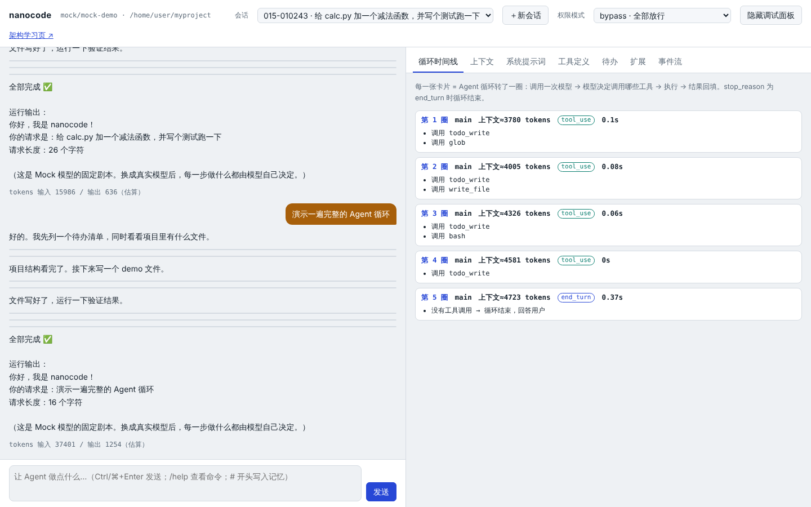
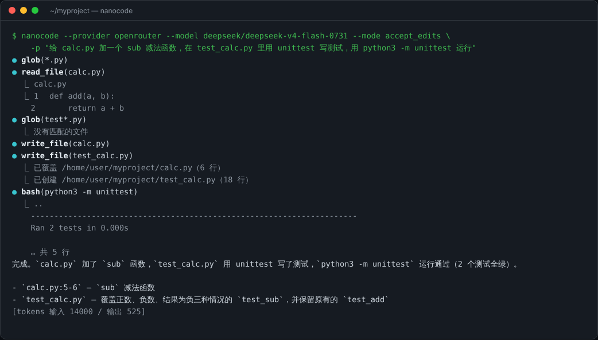
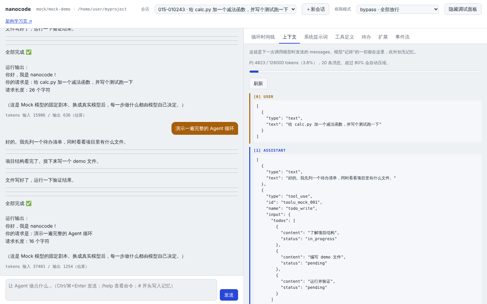
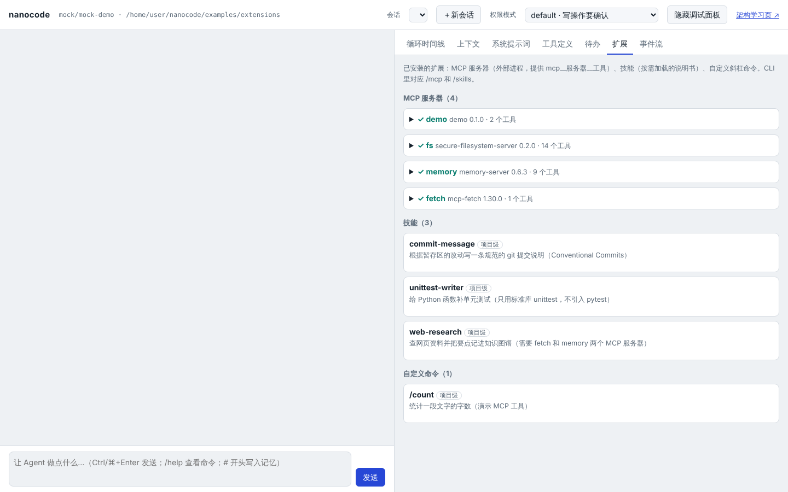
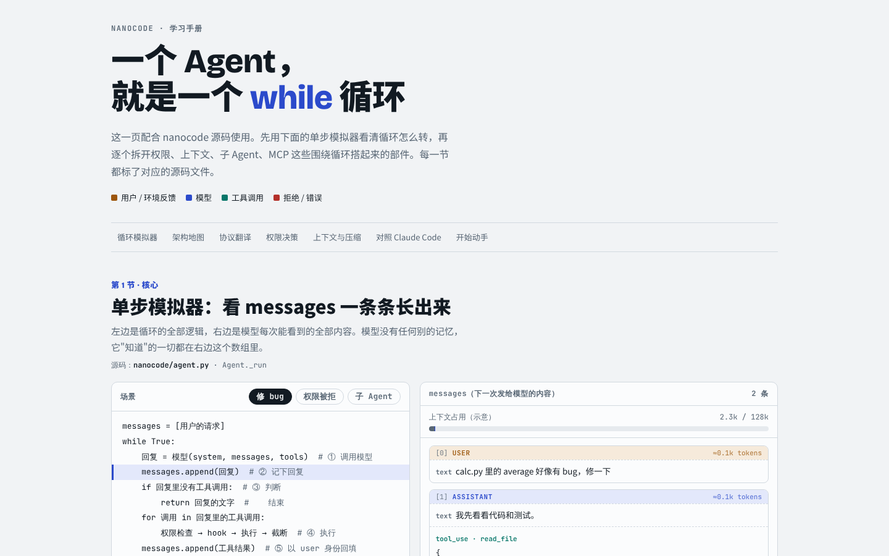
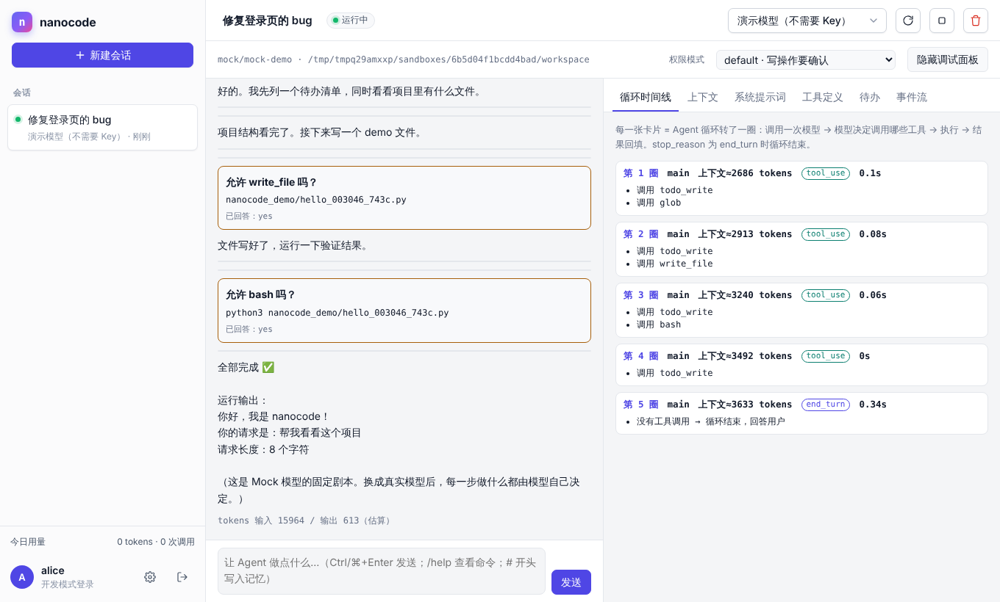
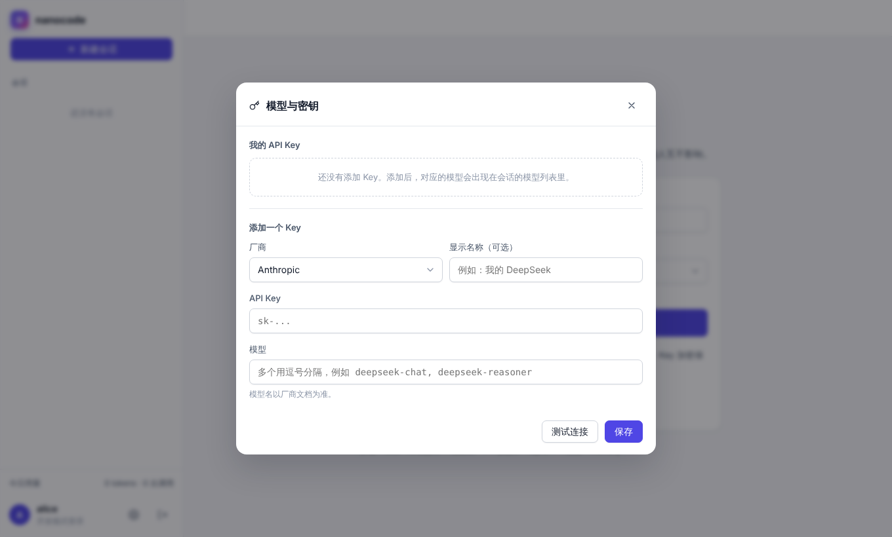
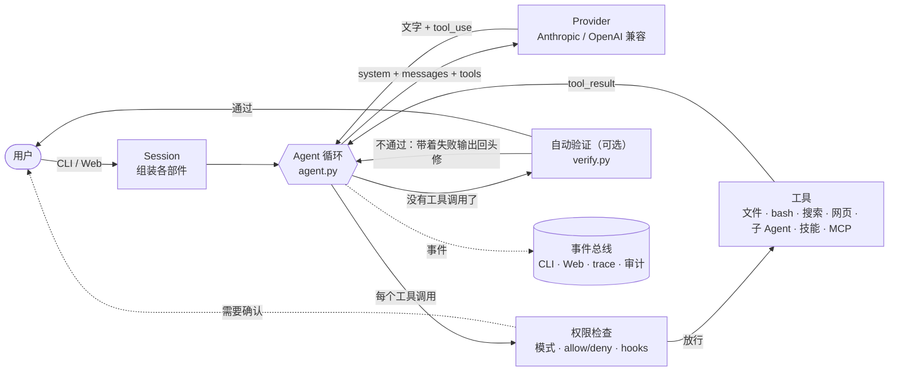
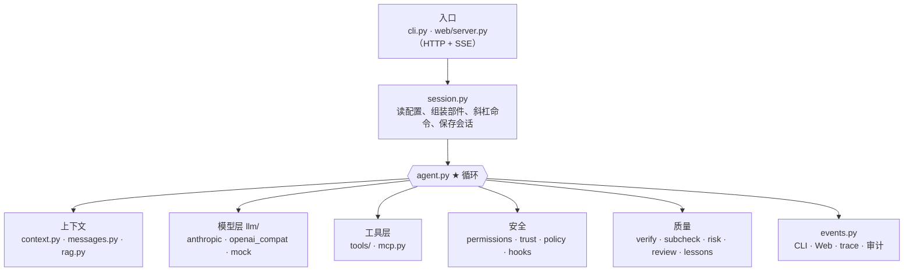
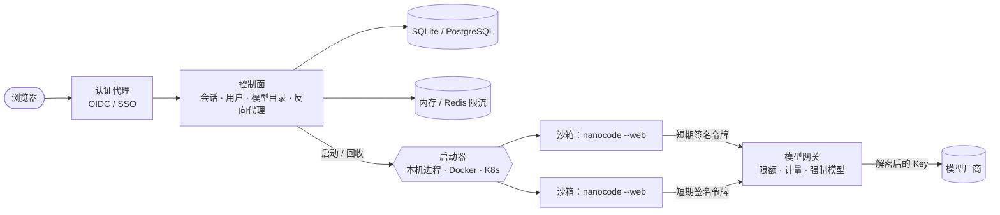

<div align="center">

# nanocode

**一个用来看懂 Agent、看懂 Claude Code 核心架构的迷你编程 Agent**

纯 Python 标准库 · 零依赖 · 每个文件都有讲解 · 不需要 API Key 就能跑起来


[30 秒跑起来](#30-秒跑起来不需要-api-key) ·
[截图](#截图) ·
[架构](#架构) ·
[怎么学](#怎么学) ·
[多用户部署](server/README.md) ·
[开发历程](docs/journey.md) ·
[写进简历](docs/resume.md)



</div>

## 亮点

- **纯 Python 标准库**，零依赖，核心代码约 5500 行（含大量中文注释），每个文件开头都有讲解
- **可接入任何一家模型**：Claude、GPT、DeepSeek、通义千问、Kimi、智谱 GLM、硅基流动、OpenRouter、本地 Ollama，或任何 OpenAI / Anthropic 兼容的中转服务
- **实现了 Claude Code 的核心机制**：Agent 循环、流式输出、文件/命令/搜索/读网页工具、权限模式与规则、Hooks、项目记忆、上下文压缩、待办清单、子 Agent、Skills、自定义斜杠命令、MCP、会话保存
- **检查 → 纠正 → 终审的闭环**：自动验证（改完先跑检查，不过就回头修）、子 Agent 验收（系统核对，不信自述）、终审模式（无害步骤自动放行、高风险永远确认、结束时汇总 diff）、经验沉淀（被打回的原因经你确认后写入项目记忆），见 [第 11 章](docs/11-verification-loop.md)
- **自带 Web 调试面板**：实时看到每一圈循环、每次发给模型的完整上下文、系统提示词、工具定义、已安装的 MCP 服务器和技能
- **自带 Mock 模型**：不需要 API Key，就能把整套流程跑起来、看清楚
- **内置小而完整的 RAG**：切块、中文 BM25、可选向量检索、RRF 混合、增量索引，外加一个评测脚本对比 grep 与检索
- **Agent 任务评测**：13 个编程任务、隐藏测试判定，统计成功率、步数和 token，用来比较模型和改动
- **多用户部署平台**（[server/](server/README.md)）：按千人规模设计的控制面 + 模型网关 + 沙箱，PostgreSQL / Redis / Docker / K8s 有就用、没有也能在单机跑
- **370+ 个单元测试**，覆盖循环的每个分支、两种协议的流式解析、检索管线、安全回归、评测框架自检，以及一个让文档和代码保持一致的测试

> nanocode 是依据 Claude Code 的公开文档和可观察行为，从零写的教学实现，不包含也不来自 Claude Code 的源代码。它追求的是"把原理讲清楚"，不是"功能一样多"。

## 截图

<table>
<tr>
<td width="50%"><b>终端：接真实模型改代码、跑测试</b><br></td>
<td width="50%"><b>上下文：模型"记得"的一切都在这里</b><br></td>
</tr>
<tr>
<td><b>扩展：MCP 服务器、技能、自定义命令</b><br></td>
<td><b>架构学习页：单步看 messages 一条条长出来</b><br></td>
</tr>
<tr>
<td><b>多用户平台：会话、模型切换、审批</b><br></td>
<td><b>多用户平台：模型与 API Key 管理</b><br></td>
</tr>
</table>

## 架构

### 一次请求是怎么走完的



循环本身只有几十行：调用模型 → 模型要用工具就执行、把结果追加进 messages → 再调用模型，直到模型不再要工具。
其余所有模块都是围着这个循环搭起来的：



### 多用户部署（千人规模）



每个会话一个沙箱，用户的 API Key 加密存在库里、只在网关解密，**沙箱里永远没有真密钥**；Docker / K8s 沙箱没有外网，只能访问网关。
设计见 [第 12 章](docs/12-distributed-deployment.md)，代码和运行方式见 [server/README.md](server/README.md)。

---

## 30 秒跑起来（不需要 API Key）

```bash
cd nanocode
python3 -m nanocode --web          # 打开 http://127.0.0.1:8765
# 或者终端版
python3 -m nanocode
```

默认使用 Mock 模型。随便输入一句话，它会按剧本演示一遍完整的 Agent 循环：列待办 → 看目录 → 写文件（请求权限）→ 运行（请求权限）→ 汇报。
在 Web 界面右侧切到「循环时间线」和「上下文」，看循环每转一圈 messages 是怎么增长的。

想安装成命令：`pip install -e .`，之后直接用 `nanocode`。要求 Python ≥ 3.10。

## 接入真实模型

| 厂商 | 命令 | API Key 环境变量 |
|---|---|---|
| Anthropic Claude | `nanocode --provider anthropic --model claude-sonnet-5-5` | `ANTHROPIC_API_KEY` |
| OpenAI | `nanocode --provider openai --model <模型名>` | `OPENAI_API_KEY` |
| DeepSeek | `nanocode --provider deepseek --model deepseek-chat` | `DEEPSEEK_API_KEY` |
| 通义千问 | `nanocode --provider qwen --model qwen-plus` | `DASHSCOPE_API_KEY` |
| Kimi | `nanocode --provider kimi --model <模型名>` | `MOONSHOT_API_KEY` |
| 智谱 GLM | `nanocode --provider glm --model <模型名>` | `ZHIPUAI_API_KEY` |
| 硅基流动 | `nanocode --provider siliconflow --model <模型名>` | `SILICONFLOW_API_KEY` |
| OpenRouter | `nanocode --provider openrouter --model <模型名>` | `OPENROUTER_API_KEY` |
| 本地 Ollama | `nanocode --provider ollama --model qwen2.5-coder` | 不需要 |
| 任意兼容服务 | `nanocode --provider custom --protocol openai --base-url https://xxx/v1 --model <模型名>` | `NANOCODE_API_KEY` |

模型名经常更新，请以各家官方文档为准。也可以把配置写进环境变量（`NANOCODE_PROVIDER`、`NANOCODE_MODEL`、`NANOCODE_BASE_URL`、`NANOCODE_API_KEY`）或 `.nanocode/settings.json`。

**选模型的提醒**：Agent 非常依赖模型的工具调用能力。小模型（尤其是 7B 以下的本地模型）经常不会调用工具或参数格式出错，这时你会在调试面板里看到大量报错 —— 这本身也是很好的学习材料。

## 常用操作

```bash
nanocode -p "解释一下 main.py"                # 单次模式，跑完就退出（适合脚本、CI）
nanocode --mode plan                          # 只读规划模式：只能看，不能改
nanocode --mode accept_edits                  # 自动允许改文件，命令仍需确认
nanocode --mode review                        # 终审模式：测试和项目内编辑自动放行，高风险操作永远确认，结束时汇总 diff
nanocode --trace                              # 把所有事件记录到 ~/.nanocode/projects/<项目>/traces/
nanocode --trust                              # 信任当前项目的配置（hooks、MCP、allow 规则等），见下方「安全」
nanocode --resume                             # 恢复上一次会话
nanocode --verify "pytest -q"                 # 自动验证：改完代码想结束时先跑这条命令，不通过就让它继续修
nanocode --cwd ~/projects/app                 # 指定工作目录（默认当前目录）
nanocode --api-key sk-xxx                     # 直接给 API Key（更推荐用环境变量，命令行会留在 shell 历史里）
```

### 自动验证：让 Agent 改完先自查

模型说"改好了"不算数。配置一条检查命令后，Agent 只要在本轮做过改动（写文件、跑 bash 等非只读操作），准备结束时就会先运行它：

- 通过 → 正常结束；
- 不通过 → 把输出末尾 4000 字符作为反馈交还给模型继续修，最多重试 `max_retries` 次（默认 3）；
- 超过次数，或者**同一个错误连续出现两次**（说明没有进展）→ 停下来，把最后一次失败输出附在回答后面交给你。单次模式（`-p`）此时退出码为 1，脚本和 CI 可以直接判断。

```jsonc
// .nanocode/settings.json（或 ~/.nanocode/settings.json）
"verify": "pytest -q"
"verify": {"command": "pytest -q", "max_retries": 3, "timeout": 300}
```

只读调查、纯问答不会触发检查。检查命令来自项目配置时，和 hooks 一样需要先信任这个项目；`--verify` 是你自己在命令行给的，直接生效。每次检查都会发 `verify` 事件，CLI 和 Web 面板都能看到第几次、通过与否。它只对主 Agent 生效；检查本身要由你保证可靠（测试写得太弱，通过也不代表对）。

### 终审模式：少被打断，但高风险永远问

`default` 事事确认，人会习惯性点"允许"；想少点几次只能在 allow 里写 `bash(*)`，但这样 `rm -rf` 也零确认。`--mode review` 在中间加了一档：

- **自动放行**：读项目内文件、改项目内文件、白名单内的检查命令（`pytest`、`unittest`、`mypy`、`ruff check`、`cargo test`、`go test`、`npm test`、`make test`，只读的 `git status/diff/log/show`、`ls/cat/grep` 等，且命令里不能有 `; & | $ >` 等拼接符）。
- **询问**：认不出的一切（失败安全：宁可多问，不会放过）。
- **永远确认**：删除、`git push / reset --hard`、提权、改权限、安装依赖、写项目外路径、写 `.env` / `.git/` / 密钥文件。**无论 allow 规则怎么写**，也没有「总是允许」。
- **结束时汇总**本轮所有改动的文件和 diff，以及自动验证结果；提交、推送仍需你确认。

局限：这是启发式规则，不是沙箱。**测试命令会执行项目里的代码，包括 Agent 刚写的**；汇总是事后给你看的，不能回滚。需要强隔离请用容器或虚拟机。

### 子 Agent 验收、经验沉淀

- **子 Agent 验收**：子 Agent 的结论后面总会附一份**系统生成**的验收报告（改了哪些文件、有没有越界、检查有没有通过，没配检查则标明"未经验证"）。`task` 工具可带 `check`（检查命令，要过权限）和 `allowed_paths`（允许修改的范围）。
- **经验沉淀**：被自动验证打回、后来修好的回合会生成一条候选约束（内容来自失败输出的原文，不是模型总结），用 `/memory accept [编号|all]` 确认后才写入项目的 `NANOCODE.md`，`/memory reject` 丢弃。

两者的原理、局限和怎么衡量有没有用，见 [第 11 章](docs/11-verification-loop.md)。

### 斜杠命令

交互模式里输入（Web 界面的输入框同样可用）：

| 命令 | 作用 |
|---|---|
| `/help` | 显示帮助 |
| `/clear` | 清空对话，开始新任务 |
| `/compact [重点]` | 手动压缩上下文 |
| `/context` | 查看上下文占用 |
| `/cost` | 查看 token 用量 |
| `/mode [模式]` | 查看 / 切换权限模式：`default` `accept_edits` `plan` `review` `bypass` |
| `/tools` | 列出可用工具 |
| `/todos` | 查看待办清单 |
| `/memory [accept\|reject [编号\|all]]` | 查看已加载的 `NANOCODE.md` 和待确认的经验候选；确认 / 丢弃候选 |
| `/init` | 让 Agent 分析项目并生成 `NANOCODE.md` |
| `/resume` | 恢复上一次会话 |
| `/providers` | 列出内置的厂商预设 |
| `/mcp` | 查看 MCP 服务器的连接状态（成功的列出工具，失败的给出原因和服务器的错误输出），见第 07 章 |
| `/skills` | 查看已安装的技能和自定义命令，以及它们来自用户目录还是项目目录 |
| `# 一句话` | 把一句话追加到项目 `NANOCODE.md`（记忆） |
| `/你的命令` | `.nanocode/commands/*.md` 里自定义的命令，见第 06 章 |

`Ctrl-C` 中断当前任务。

## 配置参考

配置合并顺序：`~/.nanocode/settings.json`（你自己的，直接生效）→ 项目 `.nanocode/settings.json` → `.nanocode/settings.local.json`；越靠后优先级越高，列表和字典会合并。**带「需信任」的项目配置在你确认信任这个项目之前不生效**（见下方「安全」）。

| 配置项 | 说明 | 项目配置里 |
|---|---|---|
| `"provider"` `"model"` `"base_url"` `"protocol"` `"headers"` | 用哪家模型、怎么连 | `provider` `base_url` `protocol` `headers` 需信任（会把 API Key 发往那里） |
| `"mode"` | 权限模式：`default` `accept_edits` `plan` `review` `bypass` | 需信任 |
| `"permissions"` | `{"allow": [...], "deny": [...]}` 规则，如 `"bash(git status*)"` | `allow` 需信任；`deny` 照常生效 |
| `"hooks"` | 生命周期钩子，见第 04 章 | 需信任 |
| `"mcpServers"` | MCP 服务器，见第 07 章 | 需信任 |
| `"verify"` | 自动验证命令，字符串或 `{"command": ..., "max_retries": 3, "timeout": 300}` | 需信任 |
| `"max_tokens"` `"context_window"` | 单次输出上限；上下文窗口大小（决定何时自动压缩） | 照常生效 |
| `"rag"` | 文档检索配置，见第 10 章 | `rag.embedding` 需信任 |
| `"suggest_memory"` | 设为 `false` 关闭经验候选提示（默认开启） | 照常生效 |

环境变量：

| 变量 | 说明 |
|---|---|
| `NANOCODE_PROVIDER` `NANOCODE_MODEL` `NANOCODE_BASE_URL` `NANOCODE_API_KEY` | 同命令行的 `--provider` 等；各厂商的 Key 变量见上表 |
| `NANOCODE_HOME` | 用户级目录（个人配置、记忆、信任记录、会话记录），默认 `~/.nanocode` |
| `NANOCODE_PERMISSION_TIMEOUT` | Web 界面里权限询问等多久没人回答就按拒绝处理，默认 600 秒 |
| `NANOCODE_PUBLIC_HOST` `NANOCODE_PUBLIC_ORIGIN` | 放在反向代理后面时信任的对外地址，见下方「安全」 |
| `NANOCODE_POLICY` | 平台策略文件（多用户部署时由平台只读挂载）：锁定模型去向、限制可选的权限模式、删除用户和项目配置里的指定键、打开审计日志；优先级高于一切配置和命令行参数，配置了却读不出来就拒绝启动。见 `policy.py` 和[第 12 章](docs/12-distributed-deployment.md#九实现状态) |
| `NANOCODE_WEB_TOKEN` | Web 界面的 API 令牌，不设则每次启动随机生成；多用户部署时由控制面注入（至少 16 个字符） |

## 目录结构

```
nanocode/
├── messages.py        统一消息格式 —— Agent 的"内存"长什么样
├── llm/               模型适配层
│   ├── base.py          Provider 接口、HTTP 重试、SSE 解析
│   ├── openai_compat.py OpenAI 兼容协议（覆盖国内外绝大多数厂商）
│   ├── anthropic.py     Claude 原生协议（含 Prompt Caching）
│   ├── mock.py          离线 Mock 模型
│   └── __init__.py      厂商预设 + 工厂函数
├── tools/             工具
│   ├── base.py          Tool 抽象、参数校验、输出截断
│   ├── files.py         read_file / write_file / edit_file
│   ├── shell.py         bash
│   ├── search.py        glob / grep
│   ├── rag_tool.py      search_docs（按含义检索文档）
│   ├── web.py           web_fetch（读网页：默认每次确认，拒绝本机和内网地址）
│   └── planning.py      todo_write / task（子 Agent）/ skill
├── agent.py           ★ 核心循环
├── rag.py             RAG：切块、BM25、向量、混合检索、增量索引
├── permissions.py     权限模式与规则（路径统一用真实路径判断，bash 复合命令按段匹配）
├── trust.py           工作区信任：陌生项目的配置不经同意不生效
├── policy.py          平台策略：多用户部署时平台下发、用户和项目都改不了的配置
├── hooks.py           生命周期钩子
├── verify.py          自动验证：改完先跑检查命令，不通过就回头修
├── subcheck.py        子 Agent 验收：修改范围、文件快照、系统生成的验收报告
├── risk.py            终审模式的风险分类：白名单放行、高风险永远确认
├── review.py          终审汇总：本轮改动的文件和 diff
├── lessons.py         经验沉淀：从失败的检查输出生成候选约束
├── context.py         系统提示词、项目记忆、技能/命令发现、上下文压缩
├── mcp.py             MCP 客户端（stdio）
├── events.py          事件总线 + trace + 审计日志
├── session.py         组装各部件、斜杠命令、会话保存（每一步自动保存）
├── cli.py             终端界面
└── web/               Web 界面：server.py（HTTP 服务 + SSE + 安全校验）、static/（调试面板 + 架构学习页）
docs/                  分章节的架构讲解（建议按顺序读）
examples/              MCP 服务器示例、扩展示例（extensions/：4 个 MCP 服务器 + 3 个技能 + 1 个命令）、RAG 评测（rag_eval/）
evals/agent_tasks/     Agent 任务评测：13 个任务、隐藏测试、参考答案、运行器
verification/          真实环境验证清单与结果（连真实模型、浏览器实操）
server/                多用户部署的控制面和模型网关（独立的包，见 server/README.md 和第 12 章）
deploy/                沙箱和控制面的镜像、Kubernetes 清单（gVisor、网络出口白名单）
tests/                 单元测试
```

## 怎么学

建议顺序：先跑起来 → 读 [docs/00-学习路线.md](docs/00-学习路线.md) → 按章节读文档，同时打开对应源码 → 做 [docs/09-练习.md](docs/09-练习.md)。

| 章节 | 内容 |
|---|---|
| [01 Agent 循环](docs/01-agent-loop.md) | 一个 Agent 的本质就是一个 while 循环 |
| [02 消息与模型适配](docs/02-messages-and-providers.md) | 统一消息格式，如何接入任何一家模型，流式输出 |
| [03 工具](docs/03-tools.md) | 工具怎么描述给模型，为什么编辑要用字符串替换 |
| [04 权限与 Hooks](docs/04-permissions-and-hooks.md) | 给 Agent 系上安全带 |
| [05 上下文工程](docs/05-context-engineering.md) | 系统提示词、项目记忆、压缩、缓存 |
| [06 待办、子 Agent、Skills](docs/06-subagents-todos-skills.md) | 让 Agent 会规划、会分工、会按需学习 |
| [07 MCP](docs/07-mcp.md) | 让任何人都能给 Agent 加工具 |
| [08 与 Claude Code 对照](docs/08-claude-code-mapping.md) | 每个模块对应 Claude Code 的哪个功能，生产级还差什么 |
| [09 练习](docs/09-练习.md) | 动手改代码，检验是否真的懂了 |
| [10 RAG](docs/10-rag.md) | 什么时候用检索而不是 grep，管线怎么搭，怎么评测 |
| [11 验证循环](docs/11-verification-loop.md) | 检查 → 纠正 → 终审：自动验证、子 Agent 验收、终审模式、经验沉淀，以及怎么衡量它们有没有用 |
| [12 分布式部署](docs/12-distributed-deployment.md) | 给 1000+ 用户使用还差什么：执行隔离、多租户、状态外置、LLM 网关、分阶段路线图和上线检查清单 |
| [13 模型视角](docs/13-model-perspective.md) | Agent 的行为从哪里来：模型实际看到什么、训练怎样塑造 Agent 能力、长上下文为什么容易出错、随机性与评测、失败模式的模型层原因、动手实验 |

开发历程：[怎么做出来的、踩过哪些坑](docs/journey.md) —— 9 个阶段的时间线，22 个真实问题的现象、原因、解决办法和教训。

找工作用：[把这个项目写进简历](docs/resume.md) —— 按岗位挑重点、能写的数字和出处、标准版 / 精简版 / 英文版写法、面试常被追问的问题、诚实的边界。

延伸阅读：[Agent 平台设计文档集](docs/platform/README.md) —— 把编程 Agent 发展成企业级、通用 Agent 平台，支撑千级、千万级、十亿级用户的愿景、架构、详细设计、路线图和架构决策记录。

## 测试、评测与验证

```bash
python3 -m unittest discover -s tests                     # 单元测试
python3 -m unittest discover -s server/tests              # 多用户部署：控制面和模型网关（见 server/README.md）
python3 evals/agent_tasks/run.py --reference              # 评测框架自检（参考答案应 13/13）
python3 evals/agent_tasks/run.py --provider deepseek --model deepseek-chat --repeat 3   # 用真实模型评测
```

T01–T10 是普通任务；T11–T13 专门设了陷阱（最容易写出的第一次尝试是错的），用来衡量自动验证这类机制有没有用，见 [第 11 章](docs/11-verification-loop.md)和 [evals/agent_tasks/README.md](evals/agent_tasks/README.md)。

三者的分工：单元测试保证代码逻辑正确（其中 `tests/test_docs_consistency.py` 保证文档和代码一一对应：命令行参数、配置项、环境变量、事件、模块、权限模式、斜杠命令、工具参数、各处写的数字，缺了会失败）；Agent 任务评测衡量"模型 + nanocode"实际能完成多少任务；
[verification/](verification/) 是需要真实环境（真实模型、浏览器）的逐项验证清单，结果汇总在 [verification/results/SUMMARY.md](verification/results/SUMMARY.md)。

## 安全

nanocode 会在你的电脑上执行模型生成的命令。默认模式下每条命令都需要你确认；`review` 模式只对白名单内的检查命令和项目内的编辑免确认，高风险操作永远确认；`bypass` 模式请只在容器或虚拟机里使用。

下面四类问题曾在本项目里真实存在，复现后修复，并由 `tests/test_security.py`、`tests/test_bash_rules.py` 钉住，避免回退：

| 问题 | 后果 | 修复 |
|---|---|---|
| 权限检查和工具各自解析路径，检查时没展开 `~`、没跟随软链接 | 读 `~/.ssh`、通过软链接读项目外文件不需要确认；accept_edits 模式下可以直接改 `~/.bashrc` | 两边共用一个函数，先展开 `~` 再取 `realpath`；路径规则也匹配规范化后的路径 |
| Web 服务不校验请求来源 | 用户开着 nanocode 时访问恶意网页，网页可以用 `text/plain` 请求或 DNS 重绑定操控 Agent | 每个请求校验 Host 和 Origin；POST 只收 JSON；`/api` 需要启动时随机生成的令牌 |
| bash 规则对整条命令做通配匹配 | `bash(python3 -m unittest*)` 放行了 `python3 -m unittest && rm -rf /`，却不认模型自己加的 `cd dir &&` 前缀；`bash(rm -rf*)` 拦不住 `cd x && rm -rf y` | 按 `&&` `;` `\|` 等拆成段：allow 每段都要命中，deny 任一段命中就拒绝；`$(…)`、反引号里藏的命令 allow 不放行（`permissions.py: split_command`） |
| 项目配置不经同意就生效 | clone 一个陌生仓库后启动 nanocode，它配置的 hooks、MCP 命令立即执行；还能改权限模式、把 API 请求发到别处 | 项目配置中的敏感项需要用户确认信任，配置变化后重新确认（`trust.py`） |

这些都是编程 Agent 的典型攻击面，详见 [docs/04-permissions-and-hooks.md](docs/04-permissions-and-hooks.md)。

### 放在反向代理后面（nginx 等）

默认只信任本机地址（`127.0.0.1` / `localhost` / `::1`），经过反向代理转发的请求，`Host` 是对外的域名或 IP，会被当成 DNS 重绑定拒绝（403）。显式告诉 nanocode 哪些对外地址可信：

```
nanocode --web --host 127.0.0.1 --port 8765 --public-host chat.example.com
# 非默认端口，或者想精确指定 Origin：
nanocode --web --public-host chat.example.com --public-origin https://chat.example.com:8443
# 也可以用环境变量（逗号分隔）：NANOCODE_PUBLIC_HOST、NANOCODE_PUBLIC_ORIGIN
```

- `--public-host`：对外的主机名或 IP，不要写通配符。会同时信任该主机名的 `http://` 和 `https://`（默认端口）Origin。
- `--public-origin`：完整的 Origin（含协议和端口），用于非默认端口。
- 反向代理需要原样转发 `Host`（nginx：`proxy_set_header Host $http_host;`），并关闭对 `/api/events` 的缓冲（`proxy_buffering off;`），否则事件流会卡住。

**这只是校验"请求是发给本服务的"，不能代替认证。** 反向代理自己必须做 TLS 和登录（如 basic auth）：页面里带着 API 令牌，任何能打开页面的人都能驱动 Agent 执行命令。


MIT License
