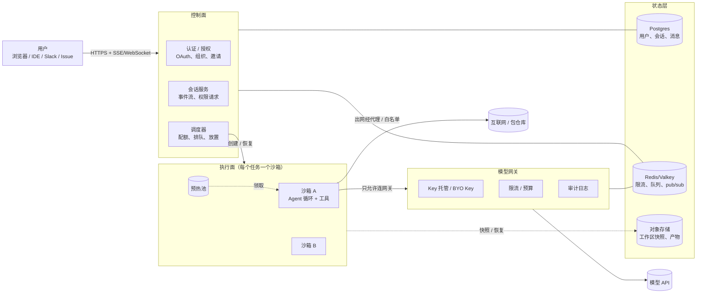
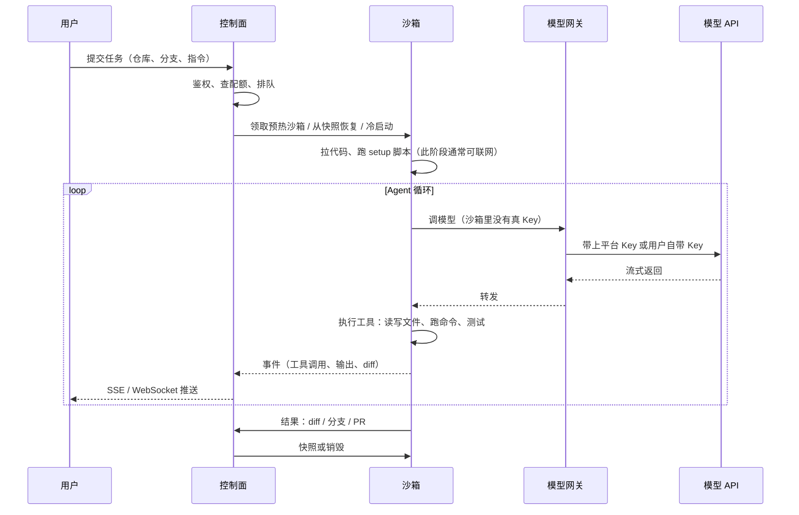
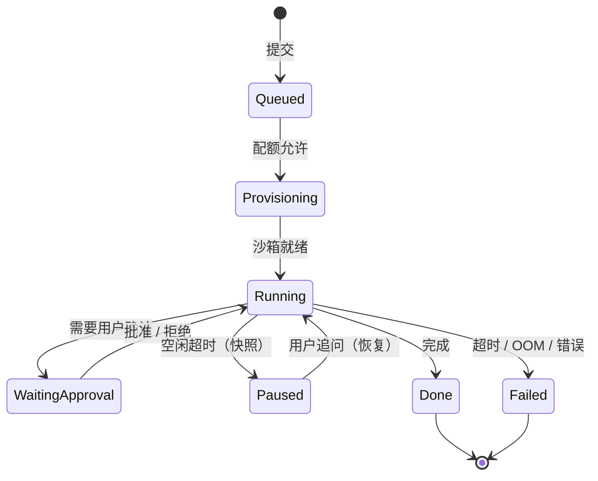
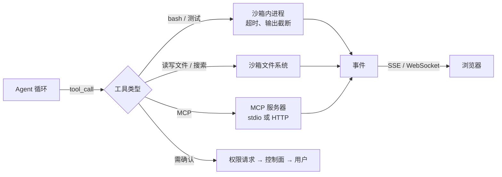
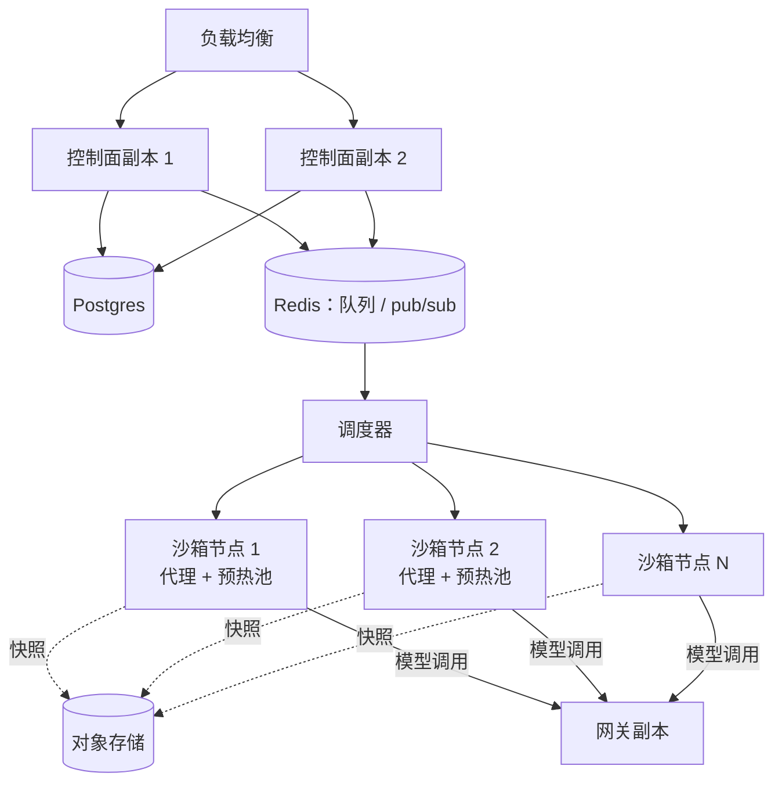
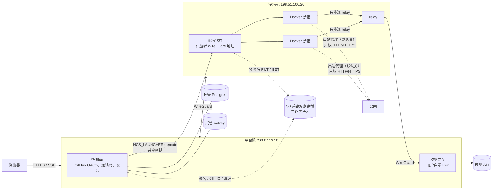

# 云端编程 Agent 的主流架构

> 这是一份**调研笔记**：主流云端编程 Agent（以及给 Agent 提供沙箱的基础设施）大体怎么搭，nanocode 现在处在哪一步、接下来补什么。
>
> 写法约定：
> - 有公开文档的地方都附了链接，说法以链接里的官方文档为准（查阅时间 2026-10）。这些产品更新很快，细节可能已经变了。
> - 各家**内部实现大多没有公开**。凡是文档没写、只是根据公开信息推断的，都标了 **（推断）**；没把握的标了 **（未证实）**。
> - 本仓库是公开的，文中所有地址、域名都是占位符（`203.0.113.10`、`nanocode.example.com` 等）。
>
> 相关文档：分布式部署：平台机 + 沙箱机 + 托管数据库（私有仓库）、[第 12 章 分布式部署](12-distributed-deployment.md)、Agent 平台设计文档集（私有仓库）。

---

## 一、一张图看全貌

几乎所有云端编程 Agent 都可以拆成同样几块：**控制面**管"谁、能做什么、在哪跑"；**执行面**是一个个隔离的沙箱，Agent 在里面跑命令、改代码；**模型网关**统一代理所有 LLM 调用；**状态层**把会话、事件和工作区存到进程之外。

一个任务的典型生命周期（各家大同小异）：

---

## 二、公开案例速览

| 产品 | 执行环境（官方说法） | 公开文档里的要点 |
|---|---|---|
| OpenAI Codex cloud | 每个任务一个容器，默认镜像 `universal` | 先跑 setup 脚本（可联网），**Agent 阶段默认断网**，可配置有限或完全联网；所有出站流量经 HTTP/HTTPS 代理；secrets 只给 setup 脚本，Agent 阶段前移除；容器状态最多缓存 12 小时。[文档](https://developers.openai.com/codex/cloud/environments) |
| GitHub Copilot cloud agent（原 coding agent） | "ephemeral cloud development environment"，环境用 `copilot-setup-steps.yml` 配置 | 只能推到自己的 `copilot/` 分支、不能自己批准/合并；默认限制访问互联网（防火墙）；会话最长 59 分钟；提交带签名并链接会话日志，便于审计。[概览](https://docs.github.com/en/copilot/concepts/agents/coding-agent/about-coding-agent)、[风险与缓解](https://docs.github.com/en/copilot/concepts/agents/cloud-agent/risks-and-mitigations) |
| Cursor Cloud Agents（原 Background Agents） | "isolated VMs in the cloud" | 环境可由 Agent 引导配置、保存快照或 `.cursor/environment.json` 里的 Dockerfile；可限制出站域名；可接私网；也支持自托管机器执行工具。[文档](https://cursor.com/docs/cloud-agent) |
| Devin | "a Linux-based virtual machine" | 环境配置保存为**快照**（可启动镜像），每个会话从同一快照的新副本启动，会话改动不写回快照。[文档](https://docs.devin.ai/onboard-devin/repo-setup) |
| E2B | "a fast, secure Linux VM"，基于 Firecracker（Firecracker 官网列出 E2B 为集成方） | 暂停时保存**文件系统和内存**，可恢复；模板定义起始环境。[文档](https://e2b.dev/docs)、[Firecracker](https://firecracker-microvm.github.io/) |
| Modal Sandboxes | 两种运行时：**gVisor** 和带独立内核的 **VM** | 默认最长 5 分钟、可设到 24 小时；空闲超时；文件系统快照；可按 `object_id` 复用实现沙箱池。[文档](https://modal.com/docs/guide/sandboxes) |
| Daytona | 自述"dedicated kernel, filesystem, network stack"，兼容 OCI/Docker | 宣称亚 100ms 启动；有快照、卷、区域。底层用的是哪种虚拟化，首页没写 **（未证实）**。[文档](https://www.daytona.io/docs/en/) |

从这张表能看出两个共同点：

1. **执行环境都是"每任务一个、用完即弃或快照"**，没有人让多个用户共用一个长期运行的容器。
2. **"准备环境"和"Agent 干活"是分开的两个阶段**：准备阶段可联网、可用 secrets，Agent 阶段收紧网络和凭据（Codex 写得最明确）。

---

## 三、控制面

控制面是普通的 Web 后端，但有几件事是 Agent 平台特有的。

### 3.1 认证与授权

- 普遍用 **OAuth 接代码托管平台**（GitHub / GitLab / Bitbucket），既是登录，也是拿仓库权限的途径。Cursor 还会在查看别人的 Agent 时**再校验一次查看者对仓库的权限**，团队成员身份不够。[来源](https://cursor.com/docs/cloud-agent)
- 触发权限要收紧：Copilot 只接受**有写权限的用户**触发，没写权限的人的评论不会给到 Agent。[来源](https://docs.github.com/en/copilot/concepts/agents/cloud-agent/risks-and-mitigations)
- Agent 拿到的仓库凭据是**最小权限、短时效**的：Copilot 只能推一个分支，且不能直接跑 `git push`。

### 3.2 会话

- 会话 = 消息历史 + 事件流 + 待处理的权限请求 + 绑定的沙箱。
- 这些都必须在**进程外**（数据库 / Redis），否则控制面多副本或重启时会话就丢了。
- 会话要能**分享、续接**：Cursor 可以把 Agent URL 发给同事只读查看；Copilot 可在 PR 里继续 `@copilot`。

### 3.3 调度与配额

- **排队**：任务先进队列，调度器按配额和容量决定何时、放到哪台机器上。
- **配额维度**：并发沙箱数、单任务最长时间（Copilot 59 分钟、Modal 默认 5 分钟）、CPU/内存/磁盘、模型 token 预算。
- **放置**：选节点时考虑镜像是否已缓存、预热池余量、用户所在区域 **（推断：各家的放置算法都没公开）**。

---

## 四、执行面：每任务一个隔离沙箱

### 4.1 隔离技术对比

| 方案 | 原理 | 隔离强度 | 启动 / 开销 | 兼容性 | 谁在用（公开信息） |
|---|---|---|---|---|---|
| Docker（runc） | Linux namespace + cgroup + seccomp，和宿主**共享内核** | 最弱：内核漏洞即可逃逸 | 最快、最省 | 最好 | Codex cloud 文档称"container"，具体运行时未公开 **（未证实）** |
| gVisor（runsc） | 用户态"应用内核"Sentry 拦截并实现系统调用，文件访问经 Gofer 进程中转 | 强：应用不直接对宿主内核发系统调用 | 接近容器，但系统调用密集型负载慢 | 不是所有 syscall / `/proc` 都实现 | Modal（gVisor 运行时）。[gVisor 文档](https://gvisor.dev/docs/) |
| Firecracker microVM | KVM 硬件虚拟化，极简设备模型（5 个设备），外加 jailer 二次隔离 | 强：独立客户机内核 | 官方称启动 <125ms、每 VM 开销 <5 MiB | 完整 Linux，但需要宿主支持 KVM（很多 VPS 不支持嵌套虚拟化） | AWS Lambda、E2B、Fly.io 等。[Firecracker](https://firecracker-microvm.github.io/) |
| Kata Containers | 用轻量 VM 跑 OCI 容器，可选 QEMU / Cloud Hypervisor / Firecracker 做 VMM | 强 | 比容器慢，比传统 VM 快 | 能接 containerd / Kubernetes | [Kata Containers](https://katacontainers.io/) |
| 完整 VM | 传统虚拟机 | 强 | 最慢、最贵 | 最好（可跑 Docker、桌面） | Cursor、Devin 文档称 VM，具体 VMM 未公开 **（未证实）** |

经验法则：

- 跑的是**不受信任的代码**（用户的仓库、被提示词注入的模型生成的命令），共享内核的普通容器不够，至少要 gVisor 或 microVM。
- 需要在沙箱里**跑 Docker、FUSE、嵌套 cgroup** 时只能用 VM（Modal 文档明确说这类负载要选 VM 运行时）。
- microVM 需要宿主机暴露 `/dev/kvm`，**便宜 VPS 往往没有**，这时 gVisor 是最现实的增强。

### 4.2 预热池

冷启动 = 调度 + 拉镜像 + 启动 + 拉代码 + 装依赖，往往是几十秒到几分钟。主流做法是分层缓存：

1. **镜像缓存**：节点上预拉好基础镜像（Codex 的 `universal`）。
2. **预热池**：提前起好一批空沙箱，任务来了直接领取。Modal 文档给出了用 `object_id` 维护沙箱池的模式。
3. **环境快照**：把"装好依赖之后"的状态存成快照，新任务从快照起（Devin、Cursor、Codex 的 12 小时容器缓存都属于这一类）。

### 4.3 快照与持久化

| 层次 | 存什么 | 例子 |
|---|---|---|
| 环境快照 | 装好工具和依赖的基础环境，所有会话共用 | Devin 的 snapshot、Cursor 的 saved snapshot |
| 会话快照（磁盘） | 某个会话的工作区文件 | Modal Filesystem Snapshots |
| 会话快照（内存 + 磁盘） | 连进程状态一起冻结，恢复后像没停过 | E2B pause/resume、Firecracker snapshot |

快照通常落在**对象存储**（S3 兼容）或节点本地盘 + 异步上传 **（推断：各家具体存储后端多未公开）**。

nanocode 实现的是"会话快照（磁盘）"这一层，细节见 distributed-deploy.md 第十节（私有仓库）：

| 设计点 | nanocode 的做法 |
|---|---|
| 什么时候存 | 沙箱停止、空闲回收、删除时在后台存；也可以手动 `POST /api/sessions/<id>/snapshot`。停止**不等**快照 |
| 什么时候恢复 | 打开会话时本地没有工作区（换了沙箱机、磁盘清过）才从最近一份恢复；坏了试更早的，都不行就让启动失败 |
| 存在哪 | S3 兼容私有桶，`<前缀>/<用户>/<会话>/<UTC 时间>.tar.gz`，每个会话保留最近 N 份（`NCS_SNAPSHOT_KEEP`） |
| 存什么 | `workspace/` + `home/`（对话记录），tar.gz；默认跳过 `node_modules`、`.venv`、各种缓存 |
| 谁持有凭据 | **只有控制面**；搬数据的沙箱代理只拿单个对象、单种操作、1 小时有效的预签名地址；沙箱容器什么都拿不到 |
| 不可信内容 | 打包不跟随符号链接（`os.fwalk` + `O_NOFOLLOW`）；恢复时流式读取、整份校验：无绝对路径 / `..` / 硬链接 / 设备，符号链接按链接表逐段解析（链式链接也不能越界），总大小和文件数边读边限；下载不跟随重定向 |
| 删除与隐私 | 删除会话默认连云端快照一起删（`NCS_SNAPSHOT_PURGE_ON_DELETE`）；手动快照单独限流，不挤占后台快照 |
| 依赖 | 无：SigV4 用标准库实现，单机不开对象存储时什么都不用装 |

---

## 五、模型网关

沙箱里**不放真正的模型 Key**，所有调用经网关。

- **Key 托管**：平台 Key 或用户自带 Key（BYO）只存在网关侧（加密存储），沙箱拿到的是短时效、绑定会话的令牌。Codex 的 secrets "only available to setup scripts…removed before the agent phase" 是同一思路在环境变量上的体现。[来源](https://developers.openai.com/codex/cloud/environments)
- **限流与预算**：按用户 / 组织 / 会话计 token 和请求数，集中处理上游 429 和重试，避免每个沙箱各自重试一起撞墙。计数通常放 Redis。
- **路由**：模型选择、故障切换、区域路由。
- **审计**：记录谁、何时、哪个会话、用了多少 token；内容是否落盘取决于隐私策略。
- 开源参考：LiteLLM Proxy、Cloudflare AI Gateway 等都提供这类能力（**未逐一核对功能细节**）。

---

## 六、工具执行与流式输出

- **Agent 循环跑在哪**：有两种放法。① 循环跑在沙箱里（沙箱只出站连网关），控制面只收事件；② 循环跑在控制面，沙箱只当"远程执行器"，每次工具调用都是一次 RPC。前者控制面更轻、断线更稳；后者更容易集中管控。公开文档一般不说明自己用哪种 **（未证实）**。
- **流式传输**：模型 token 和工具输出都要实时推给前端。
  - **SSE**：单向、基于 HTTP、过代理友好，断线后靠 `Last-Event-ID` 补发；适合"服务器推事件"。
  - **WebSocket**：双向，适合终端交互、远程桌面这类需要频繁上行的场景。
  - 多副本时，事件要经 Redis pub/sub（或类似总线）分发到持有该 SSE 连接的那个副本。
- **长任务**：命令要有超时、输出要截断；会话本身也有最长时长（Copilot 59 分钟）。
- **人在回路**：危险操作需要用户确认；Copilot 还要求 Actions 工作流必须人工批准才会跑。[来源](https://docs.github.com/en/copilot/concepts/agents/cloud-agent/risks-and-mitigations)

---

## 七、状态层

| 存储 | 存什么 | 说明 |
|---|---|---|
| Postgres | 用户、组织、邀请、会话元数据、消息、审计 | 事务、可查询；控制面多副本共享 |
| Redis / Valkey | 限流计数、队列、分布式锁、pub/sub、短期事件缓冲 | 丢了能重建的数据才放这里 |
| 对象存储（S3 兼容） | 工作区快照、日志归档、产物（截图、视频、diff） | 便宜、容量大；用预签名 URL 给前端下载，或交给执行节点上传 / 下载，长期凭据不出控制面 |
| 节点本地盘 | 运行中的工作区、镜像缓存 | 节点挂了就丢，要靠快照兜底 |

---

## 八、网络与出口控制

- **入站**：沙箱不对公网开端口；需要预览 Web 服务时由平台的隧道/反代按会话转发（Modal 的 Tunnels 是一个公开例子）。
- **出站**：
  - 默认**断网或白名单**：Codex Agent 阶段默认断网，所有流量经代理；Copilot 默认限制互联网访问；Cursor 可限制出站域名。
  - 白名单一般放包仓库（PyPI、npm）、代码托管平台、模型网关。
  - 出站统一走**代理**，才好做域名级白名单和审计（只靠 IP 防火墙挡不住 CDN 后面的域名）。
- **内网**：沙箱绝对不能访问宿主机的管理端口、云厂商元数据地址（`169.254.169.254`）、数据库和内部服务。
- **nanocode 的做法**（远程沙箱，`NCS_EGRESS_PROXY`，默认关）：沙箱机上的沙箱代理进程里内置一个只放 HTTP/HTTPS 的出站代理。沙箱没有 DNS，防火墙只放行模型 relay 和代理两个端口；`HTTP(S)_PROXY` 指向代理，`NO_PROXY` 里有 relay 地址，所以模型调用不经过它。代理自己解析域名，解析结果里只要有一个地址落在私网、CGNAT、本机、链路本地（含元数据）、ULA、WireGuard 网段、沙箱网段或沙箱机自己的地址里，就整个拒绝。检查过哪个 IP 就连哪个 IP，防 DNS 重绑定。它还有每沙箱连接上限、空闲超时、可选的域名白名单 / 黑名单，访问日志只记域名和字节数。细节见 distributed-deploy.md 3.5（私有仓库）。**生产环境打开的前提是沙箱里的令牌拿不到（#134，PR #146 已修）**，否则能上网就能把它们外传。相关：#135（审计日志可被沙箱篡改）、#136（读敏感文件默认要确认，PR #147）。
- **跨机**：控制面和沙箱节点之间走私网或加密隧道（WireGuard、Tailscale 等），Cursor 文档里就提到可以用 Tailscale 接私有网络。

---

## 九、多租户安全

把威胁按"谁可能是攻击者"排一下：

| 威胁 | 典型手段 | 主流缓解 |
|---|---|---|
| 恶意用户逃逸沙箱 | 内核漏洞、Docker socket、特权容器 | gVisor / microVM；不挂 Docker socket；非 root、只读根文件系统、`no-new-privileges`、cgroup 限额 |
| 提示词注入 | Issue / 网页 / 依赖里藏指令 | 过滤隐藏字符（Copilot 会去掉 HTML 注释）；出站白名单；危险操作要人工确认 |
| 凭据泄露 | 沙箱里读环境变量拿 Key | 沙箱里不放真 Key；secrets 只给 setup 阶段；令牌短时效、绑定会话 |
| 越权访问他人数据 | 猜会话 ID、IDOR | 每个请求按用户 / 组织校验；会话 ID 不可猜；查看时再校验仓库权限 |
| 产出被滥用 | Agent 直接推 main | 只能推专用分支；人工审查后才能合并；提交签名 + 链接会话日志 |
| 资源滥用 | 挖矿、fork 炸弹、占满连接 | 配额、超时、并发上限、单租户连接数上限、异常检测 |

---

## 十、可观测性

- **三件套**：结构化日志、指标（Prometheus 等）、链路追踪（OpenTelemetry）。trace 最好能串起"用户请求 → 调度 → 沙箱 → 每次模型调用 → 每次工具调用"。
- **Agent 特有的指标**：每任务 token 数与花费、工具调用次数与失败率、沙箱冷启动耗时、排队时长、任务成功率、人工确认等待时长。
- **会话回放**：完整的事件时间线既给用户看，也用于事后排查和审计（Copilot 的 session logs、Cursor 的 transcripts / run events）。
- **告警**：沙箱节点失联、预热池耗尽、上游 429 激增、单用户花费异常。

---

## 十一、扩展

- **控制面**无状态化后水平扩展。
- **沙箱节点**是主要的扩展单元，节点上的代理向调度器上报容量；节点池按队列长度和预热池余量自动扩缩。
- **网关**无状态，限流状态在 Redis。
- **区域化**：沙箱靠近代码托管和包仓库，控制面靠近用户 **（推断）**。

---

## 十二、对照 nanocode：现状与路线图

### 12.1 现在的设计

部署细节见 distributed-deploy.md（私有仓库）。

| 主流做法 | nanocode 现状 | 评价 |
|---|---|---|
| 控制面与执行面分离 | 平台机 + 沙箱机，WireGuard 互联，`NCS_LAUNCHER=remote` | ✅ 方向一致 |
| 认证 | GitHub OAuth + 邀请码，服务端会话 | ✅ |
| 沙箱里不放 Key | 用户 Key 留在网关，沙箱经 relay 调模型 | ✅ |
| 状态外置 | 托管 Postgres + Valkey | ✅（冷启动重试行为还要核实） |
| 沙箱网络隔离 | Docker `internal` 网络，防火墙只放行 relay 端口（#123 / PR #124） | ✅ 不能访问宿主 |
| 出站控制 | 沙箱机内置出站代理：只放 HTTP/HTTPS，代理自己解析域名并拦内网，防重绑定，可选域名白名单，按沙箱记访问日志（`NCS_EGRESS_PROXY`，默认关） | ⚠️ 代码到位，默认关；前置的 #134 已由 PR #146 修复 |
| 隔离强度 | Docker（runc），共享内核 | ⚠️ 弱于 gVisor / microVM |
| 调度 | 单台沙箱机，没有调度器 | ⚠️ |
| 预热池 | 无，每次冷启动 | ⚠️ |
| 工作区快照 | 可选：停止 / 回收 / 删除时存进 S3 兼容存储（B2 等），本地没了自动恢复；凭据只在控制面 | ✅ 磁盘快照；没有内存快照 |
| 可观测性 | 日志为主 | ⚠️ 缺指标、trace、花费统计 |

### 12.2 分阶段路线图

**阶段 0：把现有的做扎实**（当前）
- 远程沙箱（PR #126）合并、中继超时和单沙箱连接数上限到位。
- 数据库冷启动重试、Valkey 保活告警（见 distributed-deploy.md）。
- compose 资源旋钮（#119）：CPU / 内存 / pids 限额。

**阶段 1：更强的隔离**
- 沙箱机上给 Docker 加 gVisor 运行时（`runsc`），代理按配置选 `--runtime=runsc`；先跑现有测试，确认 syscall 兼容性。
- 加固默认值：非 root、只读根文件系统 + 可写工作区卷、`--cap-drop=ALL`、`no-new-privileges`。
- 出站：出站代理已实现（默认关，见 distributed-deploy.md 3.5）。#134 已修（PR #146）；在生产打开时用 `NCS_EGRESS_ALLOW_DOMAINS` 收紧到包仓库加 GitHub。
- microVM（Firecracker / Kata）留到能拿到带 `/dev/kvm` 的机器再评估。

**阶段 2：工作区快照**（已实现，见 distributed-deploy.md 第十节）
- ✅ 会话停止、空闲回收、删除时把工作区打包（tar + gzip；标准库要到 Python 3.14 才有 zstd）上传到 S3 兼容对象存储（如 Backblaze B2、MinIO、R2 的私有桶），按用户 / 会话分前缀；本地没有时下载、校验后解包。
- ✅ 对象存储凭据只在控制面；沙箱代理只拿单个对象的预签名 URL；沙箱里什么都拿不到。（最初设想把凭据放在沙箱代理侧，改成了控制面：沙箱机跑不可信代码，是更容易被打穿的那台。）
- ✅ 每个会话保留最近 N 份；桶上配生命周期规则兜底清理。
- 待做：快照计入用户配额；运行中定时快照；客户端加密。

**阶段 3：预热池**
- 每台沙箱机保持 N 个已启动、未分配的空沙箱（N 可配，按内存预算算）。
- 领取后再注入会话令牌和代码，确保池里的沙箱不带任何用户数据。

**阶段 4：多节点调度**
- 沙箱代理定期向控制面上报容量（空闲槽位、内存、预热池余量）。
- 控制面按"有预热沙箱 > 镜像已缓存 > 负载最低"选择节点；任务队列放 Redis。
- 节点失联时把会话标记为失败并提示用户从快照恢复。

**阶段 5：可观测性与运营**
- OpenTelemetry trace 串起请求 → 沙箱 → 模型调用；按用户统计 token 和花费；预热池耗尽、节点失联、429 激增告警。

---

## 参考资料

- Firecracker：<https://firecracker-microvm.github.io/>
- gVisor：<https://gvisor.dev/docs/>
- Kata Containers：<https://katacontainers.io/>
- E2B：<https://e2b.dev/docs>
- Modal Sandboxes：<https://modal.com/docs/guide/sandboxes>
- Daytona：<https://www.daytona.io/docs/en/>
- OpenAI Codex cloud environments：<https://developers.openai.com/codex/cloud/environments>
- GitHub Copilot on GitHub.com（含 cloud agent 限制）：<https://docs.github.com/en/copilot/concepts/agents/coding-agent/about-coding-agent>
- Copilot cloud agent 风险与缓解：<https://docs.github.com/en/copilot/concepts/agents/cloud-agent/risks-and-mitigations>
- Cursor Cloud Agents：<https://cursor.com/docs/cloud-agent>
- Devin 环境配置：<https://docs.devin.ai/onboard-devin/repo-setup>
