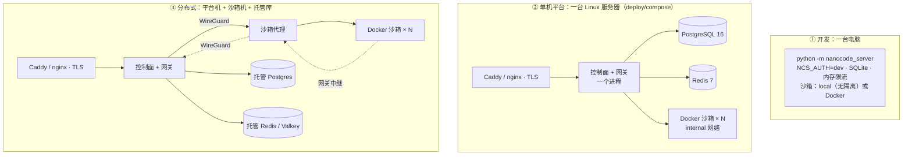
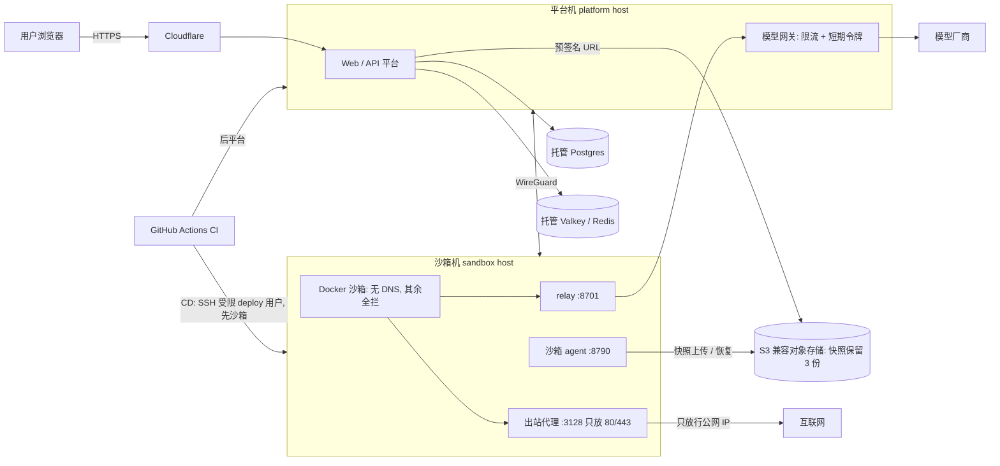

# 部署拓扑：本地单机、单机平台、分布式平台

nanocode 有两个**完全独立**的入口，先分清用哪个：

| | 本地单机（个人电脑） | 多用户平台（服务器） |
|---|---|---|
| 入口 | `nanocode` / `nanocode --web`（`nanocode/`） | `python -m nanocode_server`（`server/`） |
| 依赖 | 只要 Python ≥ 3.10 标准库，零依赖 | 可选 PostgreSQL / Redis / Docker / K8s / 远程沙箱主机 |
| 读的配置 | `NANOCODE_*`、`~/.nanocode/settings.json`、项目 `.nanocode/` | `NCS_*`（见 [configuration.md](configuration.md)） |
| 登录 | 无（本机）；对外暴露时可用 `NANOCODE_HTPASSWD` 自带登录页 | `NCS_AUTH=github` / `proxy` / `dev`（见 [auth-and-admin.md](auth-and-admin.md)） |
| 隔离 | 没有：Agent 以你的身份在你的电脑上跑，靠权限模式和确认兜底 | 每个会话一个沙箱容器 / Pod |
| 适合 | 学习、自己用 | 团队、多人 |

> **进行中**：[PR #128](https://github.com/mbaiagent/nanocode/pull/128)（未合并）把两种入口在 README 里讲清楚，加测试保证本地模式不加载 `nanocode_server` / `psycopg` / `redis`、不连外部地址、不调 `docker` / `kubectl`；`nanocode-server` 配置错误时给一句话提示并退出码 2，新增 `all` 作为一体启动的别名，并给 `server/pyproject.toml` 加 `postgres` / `redis` / `all` extras。合并前以 main 上的代码为准。

下面只讲平台的部署形态。

## 一、平台的三种形态



| | ① 开发 | ② 单机平台 | ③ 分布式 |
|---|---|---|---|
| 怎么起 | `NCS_AUTH=dev PYTHONPATH=server:. python3 -m nanocode_server` | `deploy/compose`：`docker compose --profile caddy up -d --build` | 平台机 `deploy/compose`（`NCS_LAUNCHER=remote`）+ 沙箱机 `deploy/sandbox-host` |
| 文档 | [server/README.md](../server/README.md) | [deploy/compose/README.md](../deploy/compose/README.md) | [distributed-deploy.md](distributed-deploy.md)、[deploy/sandbox-host/README.md](../deploy/sandbox-host/README.md) |
| 数据库 / 限流 | SQLite / 内存 | 本机 PG / Redis 容器（只听 127.0.0.1） | 托管 Postgres / Redis 兼容服务 |
| 沙箱在哪 | 本机 | 同一台机器 | 另一台机器（沙箱机） |
| 对外端口 | 无（只听本机） | 80/443、SSH | 平台机 80/443、SSH；沙箱机 SSH + 一个 WireGuard UDP 端口（只允许平台机） |
| 宿主机防火墙 | — | **必做**：[deploy/firewall/](../deploy/firewall/README.md)（#123） | 沙箱机必做；平台机按需 |
| 扩展 | — | 加不了机器，`NCS_REPLICAS=1` | 可加沙箱机；平台多副本要 PG + Redis |
| 用途 | 开发、演示 | 小团队；也是分布式出问题时的**回退方案** | 小机器内存吃紧、要把沙箱和数据库 / 密钥物理隔开 |

还有一种 K8s 形态（`deploy/k8s/`，gVisor + NetworkPolicy + oauth2-proxy），清单有一致性测试，但**没有在真实集群里跑过**，见 [server/README.md「生产部署」](../server/README.md#生产部署kubernetes)。

## 二、单机平台（② deploy/compose）

一台 Linux 服务器上：Caddy（可选，`--profile caddy`，自动 HTTPS）或已有 nginx → 控制面 + 模型网关（一个进程，`network_mode: host`，只听 `127.0.0.1:8700`）→ PostgreSQL / Redis（只发布到 `127.0.0.1`）→ 每个会话一个 Docker 沙箱容器。

- 沙箱容器：非 root（uid 10001）、只读根文件系统、`CapDrop: ALL`、`no-new-privileges`、CPU / 内存 / 进程数限制、`/tmp` 是限大小的 tmpfs，放在 Docker `internal` 网络（出不了外网、容器之间不通）。
- 网桥名和网段固定（`NCS_DOCKER_BRIDGE=ncs-sbx0`、`NCS_DOCKER_SUBNET=172.30.250.0/24`），宿主机防火墙只放行"沙箱 → 网关端口"，别的宿主机端口（sshd、nginx……）都连不上（#123 / PR #124）。用 `deploy/firewall/check-sandbox-isolation.sh` 验证。
- 老版本 Docker（≤ 26）只给 Subnet 建网络时 inspect 不返回 Gateway：现在建网络时显式写 Gateway，已存在的网络按网段第一个地址兜底（PR #130）。
- 1 GB 小机器的调参见 [deploy/compose/README.md「低配单机」](../deploy/compose/README.md#低配单机1-gb-内存119)。

## 三、分布式平台（③）

```
浏览器 ─HTTPS─▶ 平台机 Caddy/nginx ─▶ 控制面 127.0.0.1:8700 ──WireGuard──▶ 沙箱机 沙箱代理 <wg 地址>:8790 ─▶ 沙箱容器 :8765
                                  模型网关 <wg 地址>:8701 ◀──WireGuard── 网关中继 <沙箱网桥 .1>:8701 ◀── 沙箱容器
平台机 ──TLS──▶ 托管 Postgres          平台机 ──rediss://──▶ 托管 Redis 兼容服务
```

| 组件 | 放在哪 | 要点 |
|---|---|---|
| TLS 反向代理、控制面、模型网关 | 平台机 | 控制面只听本机；网关只听 WireGuard 地址（`NCS_GATEWAY_HOST`），平台机防火墙只允许沙箱机的隧道地址访问网关端口 |
| 沙箱代理 `sandbox-agent` | 沙箱机 | 只听 WireGuard 地址（`NCS_AGENT_BIND`，配置检查拒绝 `0.0.0.0`）；每个请求带共享密钥 `NCS_REMOTE_AGENT_SECRET`；通过本机 unix socket 操作 Docker，**Docker API 不对外** |
| 网关中继 | 沙箱机（代理进程内） | 监听沙箱网桥地址的网关端口，转到平台机网关。全局 128 / 每沙箱 16 条连接、空闲 300 秒断开（`NCS_AGENT_RELAY_*`） |
| 沙箱容器 | 沙箱机 | 同单机；**只能**连中继端口：到不了数据库、Redis、控制面、代理管理端口，也出不了外网 |
| PostgreSQL | 托管服务 | 用户、会话、邀请码、加密后的 Key |
| Redis 兼容 | 托管服务 | 限流计数（多副本共享） |

沙箱机即使被打穿，也碰不到数据库连接串、主密钥 `NCS_SECRET_KEY` 和用户的真实 Key——它们都只在平台机上。

WireGuard 的约定：**只有沙箱机开 WireGuard UDP 端口**（防火墙只允许平台机公网 IP），平台机主动连出、`[Peer]` 写 `PersistentKeepalive = 25` 维持隧道，不用开端口。详见 [distributed-deploy.md 3.1](distributed-deploy.md#31-wireguard)。

### 托管 Postgres / Redis

`deploy/compose/docker-compose.yml` 目前把 `NCS_DATABASE_URL` / `NCS_REDIS_URL` 写死成本机容器、`depends_on` 也硬依赖它们，而且 `remote` 模式下平台仍挂载 `docker.sock`、仍构建沙箱镜像（[#132](https://github.com/mbaiagent/nanocode/issues/132)，待修）。在那之前用**本机的** `docker-compose.override.yml`（不提交，和 `docker-compose.yml` 放在同一目录）绕过：

```yaml
services:
  postgres: {profiles: ["local-db"]}
  redis: {profiles: ["local-db"]}
  sandbox-image: {profiles: ["local-sandbox"]}
  platform:
    depends_on: !reset {}
    volumes: !override
      - ${NCS_HOST_DATA_DIR:-/srv/nanocode}:${NCS_HOST_DATA_DIR:-/srv/nanocode}
    environment:
      NCS_DATABASE_URL: ${NCS_EXT_DATABASE_URL:?}
      NCS_REDIS_URL: ${NCS_EXT_REDIS_URL:?}
```

`NCS_EXT_DATABASE_URL` / `NCS_EXT_REDIS_URL` 只是这个 override 里自己起的名字（代码不读），写进 root 只读（`chmod 600`）的 `.env`，不进仓库、不进聊天、不进日志。`!reset` / `!override` 需要较新的 Compose v2。

托管库的经验（细节见 [distributed-deploy.md 第四、五节](distributed-deploy.md#四托管-postgresql以-neon-免费版为例)）：

- **Postgres（以 Neon 免费版为例）**：用 pooled 地址；连接串加 `connect_timeout=15`；平台（新版 libpq）的连接串**不要**加 `options=endpoint=...`，那只给宿主机上的老 `psql`（< 14）用。缩到零后首个请求有冷启动，**不要做保活**。
- ⚠️ **已知问题**：平台的回收线程目前每 60 秒查一次库，哪怕没有沙箱在跑，托管库因此永远缩不到零，免费额度约半个月用完（[#131](https://github.com/mbaiagent/nanocode/issues/131)）。修复在 [PR #133](https://github.com/mbaiagent/nanocode/pull/133)（**未合并**）：空闲时零查询、`NCS_REAP_INTERVAL` 可配、启动连库指数退避重试约 30 秒、默认 `connect_timeout=10`。运行中坏连接重试一次等其余项仍在 #132。
- **Redis 兼容（以 Aiven Valkey 免费版为例）**：只有 TLS（`rediss://`）；长期不活跃会被关机，所以**只给它**配保活 timer + `OnFailure=` 告警。

### 生产架构图（分布式形态）

当前生产按分布式形态部署：一台平台机、一台沙箱机，中间用 WireGuard 连接。



要点：

- 真正的模型 Key 和对象存储密钥只放在平台机。
- 沙箱里只有短期令牌（默认 12 小时）和预签名地址。
- 沙箱只能连 relay 和出站代理；内网、云元数据地址和其他端口全拦。
- 主机 SSH 只允许密钥登录，并开启 fail2ban。CD 细节见 [cd.md](cd.md)。

## 四、计划中 / 进行中

| 事项 | 状态 | 说明 |
|---|---|---|
| 本地单机 vs 平台两个入口 | 进行中：[PR #128](https://github.com/mbaiagent/nanocode/pull/128) | 见本文开头 |
| 回收线程空闲时不查库 | 进行中：[PR #133](https://github.com/mbaiagent/nanocode/pull/133)（Fixes [#131](https://github.com/mbaiagent/nanocode/issues/131)） | |
| compose 支持外部库、remote 模式不挂 docker.sock、运行中连接重试 | 待修：[#132](https://github.com/mbaiagent/nanocode/issues/132) | 在那之前用上面的 override |
| 中继监听地址拒绝 `0.0.0.0` | 已实现（[#129](https://github.com/mbaiagent/nanocode/issues/129)）：启动时拒绝 `0.0.0.0` / `::` / `*`，留空 = 沙箱网桥地址 | 配错直接启动失败，不会静默暴露 |
| 沙箱出站代理（只放 HTTP/HTTPS） | 已实现（[PR #137](https://github.com/mbaiagent/nanocode/pull/137)），默认关闭 | 生产启用的前提是 [#134](https://github.com/mbaiagent/nanocode/issues/134)，已由 PR #146 修复；打开前确认镜像版本。见 [distributed-deploy.md 3.5](distributed-deploy.md#35-出站代理沙箱上网默认关)、[security-model.md](security-model.md) |
| 工作区快照到对象存储（B2 / S3 兼容） | 已实现（可选）：[PR #144](https://github.com/mbaiagent/nanocode/pull/144)，`NCS_OBJECT_STORE=s3` | 停止 / 回收时打包上传，每个会话保留最近几份，本地没有时自动恢复，删除会话默认连云端快照一起删；密钥只在平台机，沙箱机只拿预签名地址。见 [distributed-deploy.md 第十节](distributed-deploy.md#十工作区快照s3-兼容对象存储)。没开时**工作区只在沙箱机本地**（`/srv/nanocode/sandboxes/<会话>/`），备份要备那台机器 |
