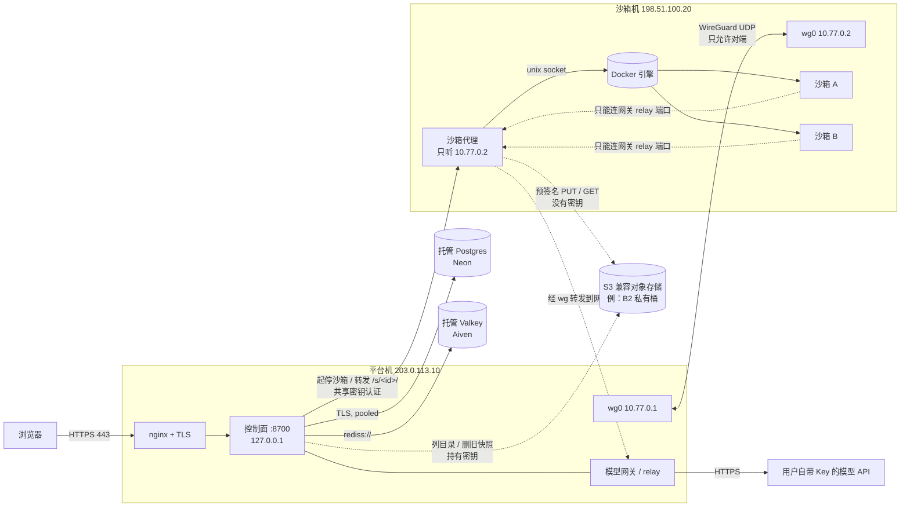
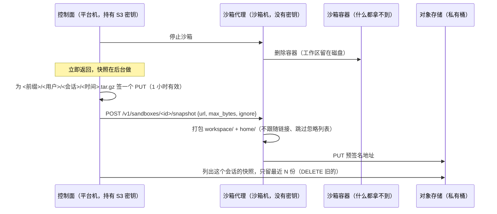

# 分布式部署：平台机 + 沙箱机 + 托管数据库

> 状态：**已实现**。宿主机隔离（[#123](https://github.com/mbaiagent/nanocode/issues/123) / [PR #124](https://github.com/mbaiagent/nanocode/pull/124)）、远程沙箱（`NCS_LAUNCHER=remote` + 沙箱代理 + 网关中继，[PR #126](https://github.com/mbaiagent/nanocode/pull/126)）和老版本 Docker 网关兜底（[PR #130](https://github.com/mbaiagent/nanocode/pull/130)）都已合并。逐步操作见 [deploy/sandbox-host/README.md](../deploy/sandbox-host/README.md)，三种部署形态的对比见 [deployment-topology.md](deployment-topology.md)，变量见 [configuration.md](configuration.md)。
> 还没解决的：回收线程让托管 Postgres 缩不到零（[#131](https://github.com/mbaiagent/nanocode/issues/131)，修复在 [PR #133](https://github.com/mbaiagent/nanocode/pull/133)，未合并）；compose 不支持外部库、remote 模式仍挂 `docker.sock`（[#132](https://github.com/mbaiagent/nanocode/issues/132)，在那之前用 [deployment-topology.md 里的 override](deployment-topology.md#托管-postgres--redis)）；中继监听地址校验（[#129](https://github.com/mbaiagent/nanocode/issues/129)）。
> 相关：#5、#106、#119；单机部署见 [deploy/compose/README.md](../deploy/compose/README.md)，总体设计见 [multiuser-1000-plan.md](multiuser-1000-plan.md)、[12-distributed-deployment.md](12-distributed-deployment.md)。

本文所有地址、域名、账号都是**示例占位符**：

| 占位符 | 含义 |
|---|---|
| `nanocode.example.com` | 对外域名 |
| `203.0.113.10` | 平台机公网 IP（RFC 5737 文档网段） |
| `198.51.100.20` | 沙箱机公网 IP（RFC 5737 文档网段） |
| `10.77.0.1` / `10.77.0.2` | WireGuard 内网地址：平台机 / 沙箱机 |
| `<endpoint-id>`、`<db-host>`、`<redis-host>` 等 | 托管服务控制台里给的值，**不要提交到仓库** |
| `<bucket>`、`<region>`、`<key-id>`、`<application-key>` | 对象存储（例：Backblaze B2）的桶名、区域、访问密钥，**不要提交到仓库** |

---

## 一、为什么拆

单机 compose 把 nginx/TLS、控制面、网关、PostgreSQL、Redis、所有沙箱容器都放在一台机器上。小 VPS（1 GB 内存）上，数据库和沙箱会互相挤内存，同时只能跑 1 个会话。

拆开之后：

| 组件 | 放在哪 | 说明 |
|---|---|---|
| nginx + TLS、控制面、模型网关 | **平台机**（一台小 VPS） | 对外只开 80/443 和 SSH |
| 每个会话的沙箱容器 + 沙箱代理 | **沙箱机**（另一台小 VPS） | 只跑沙箱；代理只听 WireGuard 地址 |
| PostgreSQL | **托管 Postgres**（例：Neon 免费版） | 用户、会话、邀请码等持久数据 |
| Redis 兼容 | **托管 Valkey/Redis**（例：Aiven Valkey 免费版） | 限流计数、跨副本事件 |
| 对象存储（S3 兼容，可选） | **托管对象存储**（例：Backblaze B2 私有桶） | 工作区快照：沙箱机磁盘丢了 / 换机器还能恢复（见第十节） |

平台机不再跑数据库和沙箱，内存宽松很多；沙箱机就算被打穿，也碰不到数据库和平台机上的密钥。

## 二、拓扑



请求路径：

1. 浏览器 → 平台机 nginx（TLS 终止）→ 控制面（只听 `127.0.0.1:8700`）。
2. 新建会话：控制面经 WireGuard 调沙箱代理 `http://10.77.0.2:<agent-port>`，带共享密钥；代理在本机 Docker 里起沙箱容器。
3. 打开会话页面 `/s/<id>/`：控制面经 WireGuard 把请求转发给代理，代理再转给沙箱容器。
4. 沙箱里的 Agent 调模型：沙箱只能连代理暴露在沙箱网桥上的 relay 端口，代理经 WireGuard 转到平台机网关，网关再带上用户自己的 Key 去调模型 API。沙箱里**没有**模型 Key。

## 三、安全边界

### 3.1 WireGuard

- 两台机器各一个 `wg0`，私网 `10.77.0.0/24`（示例），`AllowedIPs` 只写对端的 `/32`。
- 只有沙箱机需要对外多开一个 WireGuard UDP 端口，并且在防火墙里只允许平台机公网 IP 访问；平台机主动连出即可，不用开端口。
- 平台机不开端口的前提是**隧道一直由平台机维持**：沙箱机发往平台机的流量（relay → 网关）只能沿着平台机连出时留下的 conntrack 状态回程。所以平台机的 `[Peer]` 里必须写 `PersistentKeepalive = 25`，让平台机每 25 秒发一个保活包，NAT / 防火墙状态不会过期。不写的话，隧道空闲一段时间后，沙箱机这一侧先发起的包会被平台机防火墙丢掉，表现为模型调用偶发超时。沙箱机一侧不需要这个参数。
- 私钥只放在各自机器的 `/etc/wireguard/`（`chmod 600`），不进仓库，不进聊天记录。

平台机 `/etc/wireguard/wg0.conf` 示例（密钥是占位符）：

```ini
[Interface]
Address = 10.77.0.1/24
PrivateKey = <平台机私钥>

[Peer]
PublicKey = <沙箱机公钥>
Endpoint = 198.51.100.20:<wg-port>
AllowedIPs = 10.77.0.2/32
# 平台机不开 WireGuard 端口，靠它每 25 秒主动发包维持隧道和 conntrack 状态
PersistentKeepalive = 25
```

沙箱机 `/etc/wireguard/wg0.conf` 示例：

```ini
[Interface]
Address = 10.77.0.2/24
ListenPort = <wg-port>
PrivateKey = <沙箱机私钥>

[Peer]
PublicKey = <平台机公钥>
AllowedIPs = 10.77.0.1/32
```

### 3.2 沙箱代理

- **只监听 WireGuard 地址**（`10.77.0.2`），不监听 `0.0.0.0`、不监听公网 IP。
- 平台 → 代理的每个请求都带共享密钥（不少于 32 字符，例如 `openssl rand -hex 32`），代理用常量时间比较校验；密钥两边各存在 root 只读的 env 文件里。
- 代理通过本机 unix socket 操作 Docker。**Docker API 永远不对外暴露**（不开 2375/2376，也不经 WireGuard 暴露）——拿到 Docker API 等于拿到沙箱机 root。
- 代理只提供有限的操作（起、停、查状态、转发），不提供"执行任意 docker 命令"。

### 3.3 沙箱网络（依赖 #123 / PR #124）

- 沙箱网络是 Docker `internal` 网络，固定网桥名和网段（PR #124：`NCS_DOCKER_BRIDGE`，默认 `ncs-sbx0`；`NCS_DOCKER_SUBNET`，默认 `172.30.250.0/24`），防火墙规则按它们写。
- 沙箱**只能**连网关 relay 端口；宿主机上的 sshd、代理管理端口、其它服务一律不通。
- 用 `deploy/firewall/check-sandbox-isolation.sh`（PR #124）在真机上验证：relay 端口 open，其它端口 timeout。

### 3.4 firewalld zone（AlmaLinux / RHEL 系）

| zone | 绑定 | target | 放行 |
|---|---|---|---|
| `public` | 公网网卡 | default | SSH；沙箱机另加 WireGuard UDP 端口（rich rule 限定来源为平台机公网 IP）；平台机加 80/443 |
| `wg` | `wg0` | DROP | 沙箱机：只允许来源 `10.77.0.1` 访问代理端口；平台机：只允许来源 `10.77.0.2` 访问网关端口 |
| `ncs-sandbox` | 来源 = 沙箱网段 | DROP | 只开 relay 端口（由 PR #124 的 `ncs-sandbox-firewalld.sh` 创建） |

注意：不要把沙箱网段或 `wg0` 放进 `trusted` zone；Docker 默认的 `docker` zone 是 `ACCEPT`，正是 #123 的成因。

## 四、托管 PostgreSQL（以 Neon 免费版为例）

- **用 pooled 连接地址**（主机名里带 `-pooler` 的那个），控制面连接数多时不会顶满。
- **缩到零**：闲置约 5 分钟后计算节点自动休眠，下一次请求有冷启动（通常零点几秒到一两秒）。数据不会丢，只是第一个请求慢一点。
- **不要做保活 ping**：免费版每月计算时长有限（约 100 CU·小时），每几分钟 ping 一次会让节点一直醒着，几天就用完额度，额度用完库就停了。接受冷启动更划算。
- **平台自己空闲时也不查库**：回收线程只在有运行中的沙箱时才查数据库，而且最早的回收时间没到也不查（#131）；平台空闲时 Postgres 能正常缩到零。启动时连库失败会退避重试约 30 秒，冷启动不会让平台直接退出。
- 平台连接数据库要能扛住冷启动：连接超时设宽一点、首次失败重试。（接入时要在代码里核实现有的重试/连接池行为，不够就补。）
- **老版本 libpq（< 14，例如 AlmaLinux 8 自带的 psql 13）**：
  - 不支持 SNI 方式识别 endpoint，要在连接串里加 `options=endpoint%3D<endpoint-id>`；
  - 不支持 `channel_binding=require`，要去掉这个参数（保留 `sslmode=require`）。
  - 平台容器里用 psycopg 自带的较新 libpq，**平台用的连接串里不要加 `options=endpoint...`**：新版 libpq 会发 SNI，主机名是 `-pooler` 那个时，SNI 推出的名字（带 `-pooler`）和 `options` 里的 endpoint ID 对不上，Neon 直接拒绝（`Inconsistent project name inferred from SNI ... and project option ...`）。`options` 只用在宿主机上的老 `psql` 手动排查。
- 建议在平台的连接串里加 `connect_timeout=15`：libpq 默认不设连接超时，冷启动或网络抖动时宁可明确失败。

示例（全部是占位符）：

```bash
# 新版 libpq / psycopg
NCS_DATABASE_URL=postgresql://<user>:<password>@<db-host>-pooler.<region>.<provider-domain>/<dbname>?sslmode=require&channel_binding=require&connect_timeout=15
# 老版 psql 13 手动排查
psql "postgresql://<user>:<password>@<db-host>-pooler.<region>.<provider-domain>/<dbname>?sslmode=require&options=endpoint%3D<endpoint-id>"
```

## 五、托管 Redis 兼容服务（以 Aiven Valkey 免费版为例）

- 只提供 TLS：连接串是 `rediss://`（两个 s）。
- 免费版**不能选机房**。如果分到的机房离平台机远，每次 Redis 往返都多几十毫秒；限流计数这类用法能接受，不要在热路径上做大量串行调用。
- **长时间不活跃会被关机**（关机前会发邮件通知），关了要去控制台手动开。所以它**需要保活**：平台机上一个 systemd timer，每 6 小时 `PING` 一次；失败时除了写日志，还要通过 `OnFailure=` **触发告警**，否则保活坏了要等 Redis 被关机才会发现。

> systemd unit 文件只支持整行注释（行首 `#` 或 `;`），**不支持行尾注释**：`#` 后面的内容会被当成值的一部分。下面的示例注释都单独占一行，照抄时不要挪到行尾。

```ini
# /etc/systemd/system/ncs-redis-keepalive.service
[Unit]
Description=Keep managed Redis/Valkey awake
# 失败（PING 不通、env 文件缺失等）时触发告警
OnFailure=ncs-redis-keepalive-alert.service

[Service]
Type=oneshot
# 内含 NCS_REDIS_URL，root 只读 (chmod 600)
EnvironmentFile=/etc/nanocode/keepalive.env
ExecStart=/bin/sh -c 'redis-cli -u "$NCS_REDIS_URL" --tls PING | grep -q PONG'
```

```ini
# /etc/systemd/system/ncs-redis-keepalive.timer
[Unit]
Description=Ping managed Redis/Valkey every 6h

[Timer]
OnBootSec=10min
OnUnitActiveSec=6h
Persistent=true

[Install]
WantedBy=timers.target
```

```ini
# /etc/systemd/system/ncs-redis-keepalive-alert.service
[Unit]
Description=Alert: managed Redis/Valkey keepalive failed

[Service]
Type=oneshot
# 内含 NCS_ALERT_WEBHOOK_URL（你的告警 webhook 地址），root 只读 (chmod 600)
EnvironmentFile=/etc/nanocode/alert.env
ExecStart=/bin/sh -c 'curl -fsS -m 10 -H "Content-Type: application/json" -d "{\"text\":\"ncs-redis-keepalive failed on %H\"}" "$NCS_ALERT_WEBHOOK_URL"'
```

告警渠道可以换成邮件（如 `mail -s ... <收件人>`）或任何 webhook；地址、收件人都放在 root 只读的 env 文件里，不写进 unit。

```bash
sudo systemctl daemon-reload && sudo systemctl enable --now ncs-redis-keepalive.timer
sudo systemd-analyze verify /etc/systemd/system/ncs-redis-keepalive*.service   # 检查 unit 语法
sudo systemctl start ncs-redis-keepalive-alert.service                         # 手动发一条测试告警
journalctl -u ncs-redis-keepalive.service --since -1d   # 看最近的结果
```

> 不要把带密码的连接串写在 unit 文件或命令行参数里（`ps` 能看到），放在 root 只读的 EnvironmentFile 里。

## 六、和单机 compose 的取舍

| | 单机 compose | 分布式 |
|---|---|---|
| 部署复杂度 | 一条 `docker compose up` | 两台机器 + WireGuard + 两个托管账号 |
| 内存 | 数据库、平台、沙箱挤一台 | 平台机、沙箱机各自宽松 |
| 隔离 | 沙箱和数据库同机 | 沙箱机被打穿也碰不到数据库和平台密钥 |
| 延迟 | 本机 | 页面请求经 WireGuard 多几十毫秒；模型调用多一次转发；Redis 视机房而定 |
| 故障点 | 一台机器 | WireGuard、沙箱机、两个托管服务 |
| 扩展 | 加不了机器 | 可加沙箱机、平台多副本（`NCS_REPLICAS` 需要 PG + Redis） |

**单机 compose 保留**：本地开发、演示、分布式出问题时的回退方案都用它。

## 七、故障模式

| 现象 | 原因 | 影响 | 处理 |
|---|---|---|---|
| 新建会话失败 / 会话页打不开 | WireGuard 断了，或沙箱机 / 代理挂了；模型调用偶发超时多半是平台机 `[Peer]` 没配 `PersistentKeepalive` | 起不了新沙箱，已有会话的页面和模型调用都断 | `wg show` 看最近握手；`systemctl status` 看代理；控制面应返回明确的错误，而不是一直转圈 |
| 第一个请求慢 1～2 秒 | Neon 缩到零后冷启动 | 只慢一下 | 预期行为，不处理 |
| 数据库连不上（持续） | 免费额度用完、凭据轮换、服务端故障 | 登录、建会话都失败 | 看托管控制台；必要时临时切回单机 compose 自带的 PostgreSQL |
| 限流 / 事件异常，Redis 报连接错误 | Aiven 因不活跃关机，或保活 timer 停了 | 限流计数失效 | 保活失败应先收到 `OnFailure` 告警；控制台开机；查 `ncs-redis-keepalive` 日志 |
| 沙箱能连到宿主机其它端口 | 防火墙没配或被 Docker 重置 | 安全事故 | 重跑 `ncs-sandbox-firewalld.sh` 和 `check-sandbox-isolation.sh` |
| 日志里 `[snapshot] upload failed` | 对象存储不通、密钥失效、沙箱机出不了外网 | 停止照常；这次没留快照（本地工作区还在） | 看 `/api/admin/snapshots` 的 `last_error`；从沙箱机 `curl -I https://s3.<region>.backblazeb2.com` |
| 打开会话报"工作区快照都恢复不了" | 本地没有工作区，且对象存储不通或快照都坏了 | 这个会话打不开（不会拿空工作区启动） | 修好连接后刷新重试；见第十节 10.4 |

## 八、1 GB 小机器的内存预算（估算）

以下是量级估算，上线前用 `free -m`、`docker stats` 实测替换。两台都建议开约 1～2 GB swap 兜底。

**平台机（1 GB）**

| 项 | 约占用 |
|---|---|
| 系统 + sshd + nginx | 150～250 MB |
| 控制面 + 网关（一个 Python 进程） | 100～200 MB |
| 其它已有服务 | 视情况 |
| 余量 | ≥ 200 MB |

数据库和 Redis 托管出去后，平台机不再需要 PostgreSQL（数百 MB）和 Redis 的内存。

**沙箱机（1 GB）**

| 项 | 约占用 |
|---|---|
| 系统 + sshd + Docker 引擎 | 200～300 MB |
| 沙箱代理 | 50～100 MB |
| 每个沙箱容器（含 Agent 进程，`--memory` 限制） | 250～400 MB |

→ 同时 **1～2 个会话**。用并发上限（全局 / 每用户）卡住，超出排队或报"满了"，不要让 OOM killer 随机杀进程。可调的资源参数见 #119。

## 九、上线清单

> 配好 CD 后，代码升级由 [cd.md](cd.md) 的流程自动完成（main 上 CI 通过 → 先沙箱机后平台机，失败自动回滚）；下面的手动升级只作兜底。

- [x] 1. PR #124（#123 宿主机隔离）、PR #126（远程沙箱）、PR #130（Docker 网关兜底）已合并。
- [ ] 2. 两台机器：系统更新、SSH 只允许密钥登录、开 swap。
- [ ] 3. 沙箱机：装 Docker，构建沙箱镜像；跑 `ncs-sandbox-firewalld.sh`。
- [ ] 4. 两台机器装 WireGuard，生成各自密钥对，配 `wg0`（`10.77.0.1` / `10.77.0.2`），`AllowedIPs` 只写对端 `/32`，平台机 `[Peer]` 加 `PersistentKeepalive = 25`；沙箱机防火墙只对平台机 IP 开 WireGuard 端口；`wg show` 确认握手。
- [ ] 5. 配 firewalld `wg` zone（DROP，只放行对端访问指定端口）。
- [ ] 6. 生成共享密钥（`openssl rand -hex 32`），分别写进两台机器 root 只读的 env 文件。
- [ ] 7. 沙箱机启动沙箱代理（只听 `10.77.0.2`），用 systemd 管理、开机自启。
- [ ] 8. 托管 Postgres：建项目和数据库，拿 pooled 连接串；托管 Valkey：建服务，拿 `rediss://` 连接串。都只写进平台机 root 只读的 `.env`，不进仓库、不进聊天、不进日志。
- [ ] 9. 平台机 `.env`：`NCS_LAUNCHER=remote`、`NCS_REMOTE_AGENT_URL`、`NCS_REMOTE_AGENT_SECRET`、`NCS_GATEWAY_HOST=10.77.0.1`（可选 `NCS_REMOTE_GATEWAY_URL`）；数据库和 Redis 地址目前要经本机 `docker-compose.override.yml` 传入（#132，见 [deployment-topology.md](deployment-topology.md#托管-postgres--redis)）；启动平台。
- [ ] 10. 配 Redis 保活 timer 和 `OnFailure=` 告警 unit；`systemd-analyze verify` 通过，手动触发一次告警**确认能收到**；**不要**给 Postgres 配保活。
- [ ] 11. 验证：`curl http://127.0.0.1:8700/healthz`；登录、建会话、打开 `/s/<id>/`、调一次模型；沙箱里跑 `check-sandbox-isolation.sh`；从公网扫沙箱机，确认只开 SSH 和 WireGuard。
- [ ] 12. 演练回退：停掉 WireGuard，确认控制面报错清楚；恢复后新会话正常。
- [ ] 13. （可选）工作区快照：建私有桶和只限这个桶的密钥，写进平台机 `.env`（第十节）；先升级沙箱代理再升级平台；停一个会话确认 `[snapshot] uploaded`，再做一次恢复演练。

## 十、工作区快照（S3 兼容对象存储）

不开的时候（默认 `NCS_OBJECT_STORE=off`），工作区只在沙箱机本地盘 `<数据目录>/sandboxes/<会话>/data/` 下，沙箱机坏了就没了。开了之后，沙箱停止 / 空闲回收 / 删除时把工作区打包存进 S3 兼容的对象存储（Backblaze B2、MinIO、Cloudflare R2、AWS S3 都行），下次打开会话时本地没有就自动恢复。

代码：`server/nanocode_server/storage/objectstore.py`（S3 客户端，纯标准库 SigV4）、`runtime/snapshot.py`（打包 / 校验 / 恢复）、`services/snapshots.py`（生命周期、重试、保留份数）。**不需要 boto3**，单机模式不开对象存储时什么都不用装。

### 10.1 谁持有密钥、谁搬数据



| 方案 | 沙箱机被打穿时 | 结论 |
|---|---|---|
| 沙箱机上放桶级密钥（哪怕只限这一个桶） | 能读、改、删**所有用户**的快照 | ✗ |
| **控制面持有密钥，沙箱机只拿预签名地址（本方案）** | 只能对正在打包 / 恢复的那**一个对象**做**一种操作**，1 小时后作废；而那些工作区本来就在它的磁盘上 | ✓ |
| 数据经控制面中转 | 同上，但工作区大小的流量要走两次 WireGuard，1 GB 的平台机扛不住 | ✗ |

沙箱机跑的是不可信代码，是两台机器里更容易被打穿的一台，所以密钥放在平台机。列目录、删旧快照这些需要桶级权限的操作只在控制面做。沙箱容器拿不到任何东西：预签名地址只出现在控制面 → 代理的管理接口里（WireGuard + 共享密钥），打包和上传都在容器外、容器停掉之后。单机 / Docker 模式下"搬数据的一方"就是控制面自己，代码路径相同。

### 10.2 生命周期

| 事件 | 行为 |
|---|---|
| 用户点停止、空闲回收（`NCS_IDLE_TIMEOUT`）、管理员停用账号 | 先停容器（**不等快照**），再在后台打包上传 |
| 换模型 | 停了马上重启，不存快照 |
| 删除会话 | 停容器、标记删除；默认（`NCS_SNAPSHOT_PURGE_ON_DELETE=1`）在后台**删掉桶里这个会话的全部快照**，再删本地工作区（排着的快照先做完，免得删完又传上去一份）。关掉 purge 并设 `NCS_SNAPSHOT_ON_DELETE=1`：改为先存最后一份再删本地，云端快照留着方便误删找回 |
| 打开已停止的会话 | 本地有工作区：直接启动。本地没有（换了沙箱机、磁盘清过）且会话以前启动过：先下载最近一份恢复再启动 |
| 同一个会话的快照还在后台跑时又被打开 | 启动先等它结束（最多 5 分钟），不会一边打包一边写 |
| 手动 | `POST /api/sessions/<id>/snapshot`（会话主人，运行中也可以）；`GET /api/sessions/<id>/snapshots` 列出快照。手动快照**单独一个名额**、不占后台的 2 个名额；已有手动快照在跑就立即回 409，不排队，所以连点也挡不住别人的停止快照 |
| 管理员 | `GET /api/admin/snapshots`：上传 / 失败 / 重试 / 恢复 / 清理计数和最近一次错误 |
| 控制面退出 | 不再等重试退避；正在上传的最多等 30 秒 |

快照内容是沙箱数据目录下的 `workspace/`（项目文件）和 `home/`（对话记录、nanocode 配置）；平台策略、pid、日志每次启动都会重新生成，不进快照。

### 10.3 打包和恢复的安全校验

打包和恢复都以沙箱机上的 root 运行，而工作区内容由沙箱里的 Agent 完全控制（可能被提示词注入）。

打包时：

- **不跟随符号链接**：用 `os.fwalk` + `O_NOFOLLOW` 按目录 fd 逐级打开，打包过程中把文件换成链接也绕不过去。沙箱里 `ln -s /etc/shadow x` 不会把宿主机文件打进快照。
- 只收普通文件、目录和**指向快照内部的相对**符号链接（字符串检查 + 按磁盘上的真实解析确认，链式链接也算）；设备、FIFO、socket、指向外面的链接一律跳过（计入 `skipped`）。
- 权限去掉 setuid / setgid / sticky，属主写成 0。
- 未压缩总大小超过 `NCS_SNAPSHOT_MAX_BYTES` 直接失败，不传半个快照；文件数上限 20 万。
- 默认忽略（按文件名 / 目录名匹配，任意层级）：`node_modules`、`.venv`、`venv`、`__pycache__`、`.cache`、`.npm`、`.pnpm-store`、`.yarn`、`.mypy_cache`、`.pytest_cache`、`.ruff_cache`、`.tox`、`.nox`、`.gradle`、`.next`、`.nuxt`、`.turbo`、`.parcel-cache`、`*.pyc`。追加用 `NCS_SNAPSHOT_IGNORE`。

恢复时（归档来自对象存储，按"可能被篡改"处理），**先完整校验，任何一项不合格整份拒绝**：

- 不能有绝对路径、`..`、反斜杠、盘符；顶层只能是 `workspace/` 或 `home/`；不能有重复路径；
- 只允许普通文件、目录、符号链接；**硬链接、字符 / 块设备、FIFO 一律拒绝**；
- 符号链接必须是相对的，并且**按归档里的链接表逐段模拟解析**（遇到归档内的链接就展开，`..` 作用在展开后的物理位置上，最多展开 40 次、成环即拒绝），最终必须落在 `workspace/` 或 `home/` 下。只做字符串规范化挡不住链式链接，例如 `home/a/b/k -> ../../../workspace` 加 `workspace/l -> ../home/a/b/k/../../..`，两条各自看都在里面，物理上却指到根目录上两级——这个例子就是测试用例；
- 任何路径的上级都不能是归档里的符号链接（"先建链接、再顺着链接写文件"的穿越）；
- **流式读取**（不先把全部成员头读进内存）：边读边计数，文件数超过 20 万或解压后总大小超过 `NCS_SNAPSHOT_MAX_BYTES` 立即停止；下载的压缩包 ≤ 上限 + 5% + 16 MiB（防解压炸弹）；
- 解压到全新的临时目录：文件用 `O_CREAT|O_EXCL|O_NOFOLLOW` 创建，符号链接全部读完、整体校验通过后最后才建，全部成功后才换进工作区位置；本地已有非空工作区时**不覆盖**；
- 下载 / 上传预签名地址**不跟随 HTTP 重定向**（对象存储不该回 3xx），少一个被引到别处的口子。
- Docker 启动器把工作区 chown 给沙箱用户时不跟随符号链接（本 PR 一并修复：以前 `os.chown` 会跟随链接，沙箱里的 `ln -s /etc/shadow` 能让 root 把宿主机文件交给沙箱用户）。

这些都有测试：`server/tests/test_snapshots.py` 的 `TarTraversalTest`、`PackRestoreTest`。

### 10.4 保留与失败

- **对象 key**：`<NCS_S3_PREFIX>/<用户 id>/<会话 id>/<UTC 时间到毫秒>Z.tar.gz`，例如 `snapshots/gh-12345/AbCdEfGh12345678/20260101T120000123Z.tar.gz`。用户 id 只保留 `[A-Za-z0-9._-]`，有替换时加一段哈希防撞。
- **保留**：每次上传成功后列出这个会话的快照，只留最近 `NCS_SNAPSHOT_KEEP` 份（默认 3）。
- **删除会话**：默认连云端快照一起删（`NCS_SNAPSHOT_PURGE_ON_DELETE=1`，隐私优先）。清理失败重试 3 次，之后只记日志（`[snapshot] purge failed`，计数 `purge_failed`），桶的生命周期规则兜底。关掉 purge 时这个会话的快照会一直留在桶里，直到生命周期规则清掉。
- **上传失败**：后台重试 3 次（间隔 5 秒、30 秒），**从不阻塞停止**；超过大小上限这类"重试也没用"的错误不重试。每次失败都有一行日志，`/api/admin/snapshots` 里计数。
- **清理失败**：只记日志，下次上传成功时再清。
- **恢复失败**：最近一份坏了就试更早的（网络错误每份重试一次）；**全都恢复不了，这次启动失败**并把原因显示给用户——不能拿空工作区启动，否则下次停止时空快照会把好快照挤出保留名额。处理：查日志 → 修好对象存储连接后重试；确认快照真的都坏了，删掉这个会话前缀下的对象后再打开（得到空工作区）。
- 日志行（`docker compose logs platform | grep '\[snapshot\]'`）：

```text
[snapshot] uploaded session=<id> bytes=… raw=… files=… skipped=… seconds=…
[snapshot] upload failed session=<id> attempt=2/3: 上传快照失败：对象存储返回 HTTP 503
[snapshot] restored session=<id> from=<时间>Z.tar.gz files=… bytes=…
[snapshot] restore failed session=<id> from=… attempt=1: …
[snapshot] prune failed session=<id>: …
[snapshot] purged session=<id> objects=…
[snapshot] purge failed session=<id> attempt=1/3: …
```

日志和报错里**不会**出现预签名地址的查询串（里面有签名）和密钥。

### 10.5 配置 Backblaze B2（其它 S3 兼容服务同理）

1. B2 控制台建一个 **Private** 桶 `<bucket>`；记下桶详情里的 S3 Endpoint：`s3.<region>.backblazeb2.com`，`<region>` 形如 `us-west-NNN`。
2. Application Keys → Add a New Application Key：**只允许访问这个桶**，权限 Read and Write。得到 `keyID`（`<key-id>`）和 `applicationKey`（`<application-key>`，只显示一次）。
3. 桶的 Lifecycle Settings 选 **Keep only the last version of the file**。B2 的桶默认保留所有版本，S3 接口的 DELETE 只是"隐藏"，不配这条的话按保留份数删掉的旧快照仍然占空间、照样计费。
   （可选）再加一条按前缀 `snapshots/` 的规则，上传 N 天后隐藏，兜底清理已删除会话的快照。注意它对所有快照生效：N 天没再停止过的会话，快照也会被清掉；N 按你愿意保留闲置工作区多久来定。
4. 把下面几行写进**平台机** root 只读（`chmod 600`）的 `deploy/compose/.env`，经 SSH 管道写入，不要贴进终端或聊天：

```bash
NCS_OBJECT_STORE=s3
NCS_S3_ENDPOINT=https://s3.<region>.backblazeb2.com
NCS_S3_REGION=<region>
NCS_S3_BUCKET=<bucket>
NCS_S3_ACCESS_KEY_ID=<key-id>
NCS_S3_SECRET_ACCESS_KEY=<application-key>
NCS_S3_PREFIX=snapshots
NCS_SNAPSHOT_KEEP=3
NCS_SNAPSHOT_MAX_BYTES=1Gi
```

如果凭据已经以别的名字存在平台机的某个 root 只读文件里，可以在服务器上直接转换，值不经过终端输出：

```bash
sudo sh -c '. /path/to/creds.env && umask 077 && {
  printf "NCS_OBJECT_STORE=s3\n"
  printf "NCS_S3_ENDPOINT=%s\n" "$EXISTING_ENDPOINT"
  printf "NCS_S3_REGION=%s\n" "$EXISTING_REGION"
  printf "NCS_S3_BUCKET=%s\n" "$EXISTING_BUCKET"
  printf "NCS_S3_ACCESS_KEY_ID=%s\n" "$EXISTING_KEY_ID"
  printf "NCS_S3_SECRET_ACCESS_KEY=%s\n" "$EXISTING_SECRET"
} >> /path/to/deploy/compose/.env'
```

（`NCS_S3_ENDPOINT` 要带 `https://`；原文件里只有主机名时写成 `"https://$EXISTING_ENDPOINT"`。）

5. **沙箱机不需要任何新配置**：它没有密钥，只用控制面给的预签名地址。只要确认沙箱机本身（不是沙箱容器）能出站访问 `https://s3.<region>.backblazeb2.com`（代理是 host 网络）。沙箱容器仍然没有外网。
6. 重启：沙箱机 `docker compose up -d --build agent`（新版代理才有快照接口），平台机 `docker compose up -d --build platform`。先升级代理，再升级平台。
7. 验证：

```bash
docker compose logs platform | grep 工作区快照              # 启动信息里有 "工作区快照 s3 <bucket>"
# 新建会话、写个文件、点"停止"，然后：
docker compose logs platform | grep '\[snapshot\] uploaded'
# 管理员登录后访问 /api/admin/snapshots，uploaded 应该 ≥ 1、upload_failed = 0
```

恢复演练：停掉一个会话，在沙箱机上把 `<数据目录>/sandboxes/<会话>` 挪走，再打开会话，文件应该回来，日志有 `[snapshot] restored`。

### 10.6 变量

| 变量 | 设在哪 | 说明 | 默认 |
|---|---|---|---|
| `NCS_OBJECT_STORE` | 平台机 | `off` / `s3` | `off` |
| `NCS_S3_ENDPOINT` | 平台机 | S3 API 地址，必须 `https://`（只有本机 MinIO 可以 `http://127.0.0.1:…`），path-style 访问 | — |
| `NCS_S3_REGION` | 平台机 | 签名用的区域，B2 是 endpoint 里那段 `<region>` | `us-east-1` |
| `NCS_S3_BUCKET` | 平台机 | 私有桶名 | — |
| `NCS_S3_ACCESS_KEY_ID` / `NCS_S3_SECRET_ACCESS_KEY` | 平台机（root 只读 .env） | 只限这个桶的读写密钥 | — |
| `NCS_S3_PREFIX` | 平台机 | key 前缀 | `snapshots` |
| `NCS_SNAPSHOT_KEEP` | 平台机 | 每个会话保留几份（1–100） | `3` |
| `NCS_SNAPSHOT_MAX_BYTES` | 平台机 | 工作区未压缩大小上限（1Mi–5Gi，认 `512Mi`、`1g` 写法），恢复时同样限制解压大小 | `1Gi` |
| `NCS_SNAPSHOT_IGNORE` | 平台机 | 追加的忽略规则，逗号分隔的文件名通配，例如 `*.log,dist` | 空 |
| `NCS_SNAPSHOT_PURGE_ON_DELETE` | 平台机 | 删除会话时删掉桶里这个会话的全部快照 | `true` |
| `NCS_SNAPSHOT_ON_DELETE` | 平台机 | 只在 purge 关掉时生效：删除前先存最后一份 | `false` |

沙箱机：**无新增变量**。K8s 启动器不支持（工作区在 PVC 里，用存储类自己的卷快照），配了 `NCS_OBJECT_STORE=s3` 会拒绝启动。

## 十一、隐私提醒（本仓库是公开的）

提交文档、配置、日志之前检查：没有真实 IP、域名、托管服务的主机名 / endpoint ID / 项目 ID、账号邮箱、密码和令牌。示例一律用本文开头的占位符（RFC 5737 文档网段、`example.com`）。提交前可以跑 `gitleaks` 扫一遍。
