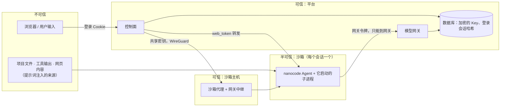

# 安全模型与信任边界

> 本文汇总 nanocode（单机）和 nanocode-server（多用户平台）**现在**的安全边界、已知弱点和在修的问题。
> 单机的攻击面和修复记录见 [README「安全」](../README.md#安全) 和 [第 04 章](04-permissions-and-hooks.md)；平台的逐项设计见 [server/README.md「几个关键的安全设计」](../server/README.md#几个关键的安全设计)。
> 发现问题请提 issue（本仓库公开：不要在 issue 里贴真实 IP、域名、密钥）。

## 一、一句话

**权限系统是启发式闸门，不是沙箱。** 真正的隔离靠容器（非 root、只读根、无 capabilities、seccomp）、网络隔离和宿主机防火墙；权限模式、allow/deny 规则、风险分类只是减少误操作和提示词注入的损失。

## 二、信任边界

| 边界 | 谁在里面 | 挡什么 | 靠什么 |
|---|---|---|---|
| 用户 ↔ 平台 | 浏览器 | 冒充他人、跨站请求、暴力登录、点击劫持 | GitHub OAuth + 邀请码、服务端登录会话、CSRF 检查、登录限速（[auth-and-admin.md](auth-and-admin.md)）；控制面页面 CSP + `frame-ancestors 'none'` + `X-Frame-Options: DENY`，`/s/<id>/` 转发的面板由平台加 CSP（只允许同源嵌入，不用沙箱自己发的头，#113） |
| 用户 ↔ 用户 | 不同 owner 的会话 / Key / 工作区 | 越权访问 | 所有查询按 owner 过滤，别人的一律 404；每会话一个沙箱；端到端隔离测试（`demo`） |
| 沙箱 ↔ 平台 | Agent 和它的子进程 | 偷真实 Key、改模型去向、访问数据库 / 控制面 / 其它宿主机端口 | 真实 Key 只在网关；平台策略只读挂载；internal 网络 + 宿主机防火墙只放行网关（或中继）端口（#123） |
| 沙箱 ↔ 互联网 | Agent | 数据外传、下载恶意代码 | **目前没有外网**（无 DNS、无路由），这是现阶段最主要的缓解 |
| 平台 ↔ 沙箱主机 | 沙箱代理 | 远程起停任意容器、拿到 Docker API | 代理只听 WireGuard 地址、共享密钥、只暴露有限接口；Docker API 不对外（#126） |
| 单机 Agent ↔ 你的电脑 | 本地 nanocode | 误删、越界写、陌生项目配置执行命令 | 权限模式、真实路径判定、复合命令拆段、项目配置信任（`trust.py`）。**没有隔离** |

## 三、沙箱里实测到的状态

在平台的 Docker 沙箱里实测（2026-10）：

- 做得好的：非 root（uid 10001）、`CapEff=0`、`NoNewPrivs=1`、seccomp 过滤开启；根文件系统和平台策略目录只读，`/tmp` 不能执行；读不到 `/etc/shadow`；没有外网（DNS 解析失败）。
- 权限判定失败安全：deny → plan → allow → bypass → 只读 → accept_edits → ask，非交互时 ask 按 deny；路径按真实路径判定（`~`、`..`、软链接），执行前复核（#42 / PR #108）。
- 项目配置里的敏感键（hooks、MCP、`base_url`、`permissions.allow` 等）首次使用要信任确认并记内容指纹；平台策略优先级最高，读不出来就拒绝启动。
- `bypass` 模式默认不在平台允许的模式里（`NCS_SANDBOX_MODES`），`local` 启动器禁止开启。

## 四、已知弱点（open issues）

| 问题 | 影响 | 现在的缓解 | 跟踪 |
|---|---|---|---|
| 沙箱环境变量里有网关令牌 `NANOCODE_API_KEY` 和 `NANOCODE_WEB_TOKEN`，任何子进程（`env`、`/proc/self/environ`）都能读到 | 提示词注入后一条命令就能拿到。网关令牌不是真实 Key（签名、有过期、绑定会话代次、只能调平台网关），但仍能在有效期内消耗该用户的额度；web token 能驱动这个沙箱 | bash / verify / hook 子进程拿不到 `NANOCODE_*`、`NCS_*`、厂商 Key 和像密钥的变量（`NANOCODE_TOOL_ENV_KEEP` 可放行后两类）；Web 进程不可 dump，读不到父进程 environ；沙箱没有外网；网关只在内网可达；停止 / 重启沙箱会让旧令牌失效；`NCS_RPM` / `NCS_DAILY_TOKENS` 封顶消耗。仍有残留：同进程内的 Python 工具、读得到的文件 | [#134](https://github.com/mbaiagent/nanocode/issues/134) |
| 审计日志 `audit.jsonl` 写在沙箱数据目录，属主是 agent 用户 | 被攻陷的 agent 能改写或截断审计记录，只能作事后参考 | 无 | [#135](https://github.com/mbaiagent/nanocode/issues/135) |
| 读文件默认放行，`.env`、`*.pem`、`*.key`、`id_rsa` / `id_ed25519`、`.netrc`、`.aws/credentials` 被读时不确认 | 提示词注入可以把这些内容读进上下文 | 读取这些文件默认询问、非交互拒绝，宽泛 allow 规则不放行；bash 常见读法启发式识别（`python -c`、`grep -r` 等看不穿）；模式可由 `permissions.sensitive_read(_exclude)` 和平台策略调整，见 [04 章](04-permissions-and-hooks.md#敏感文件读取136) | [#136](https://github.com/mbaiagent/nanocode/issues/136) |
| 权限分类是字符串启发式：`bash -c "…"`、`xargs`、别名、变量展开看不穿；`risk.py` 只做正则识别 | 不能把 allow/deny 规则当成安全边界 | 容器隔离兜底；`review` 模式高风险永远确认 | 设计如此，见 [第 04 章](04-permissions-and-hooks.md)、[第 11 章](11-verification-loop.md) |
| 网关中继监听地址 `NCS_AGENT_RELAY_BIND` 没有拒绝 `0.0.0.0` 的校验 | 配错时中继暴露到公网 | 保持为空（默认监听沙箱网桥地址）；沙箱机防火墙 | [#129](https://github.com/mbaiagent/nanocode/issues/129) |
| `remote` 模式下平台容器仍挂载 `docker.sock` | 平台容器等于宿主机 root，没有必要 | 平台机本来就是可信组件 | [#132](https://github.com/mbaiagent/nanocode/issues/132) 第 2 点 |
| 沙箱面板 `/s/<id>/` 和控制面同源，浏览器同源请求会带上控制面登录 Cookie | 面板一旦有 XSS，脚本能以用户身份调 `/api/credentials`、`/api/sessions` | 面板 CSP 只允许同源脚本和内联脚本、平台统一加安全头（#113）；面板输出做了转义和链接过滤（#89、#90） | [#114](https://github.com/mbaiagent/nanocode/issues/114) |
| 控制面进程也持有解密用的 SecretBox | 控制面被攻破 = Key 泄露 | 威胁模型里控制面本身是可信组件 | 设计如此，见 server/README |

## 五、出站代理（已实现，默认关）与它的前置条件

用户需要沙箱里能 `pip install`、`web_search`、`web_fetch`。远程沙箱有一个**只放行 HTTP/HTTPS** 的出站代理（`NCS_EGRESS_PROXY`，默认关，[PR #137](https://github.com/mbaiagent/nanocode/pull/137)）：
- 只做 CONNECT 和明文 HTTP，目标端口默认只放 80/443；DNS 由代理解析，沙箱里没有 DNS；
- 拒绝内网、CGNAT、本机、链路本地（含云元数据）、ULA、WireGuard 网段、沙箱网段和沙箱机自己的地址；
- 检查过哪个 IP 就连哪个 IP，防 DNS 重绑定；
- 每个沙箱有连接上限和空闲超时；
- 访问日志只记域名和字节数；
- 沙箱通过 `HTTP_PROXY` / `HTTPS_PROXY` 使用它，防火墙只多放行代理端口。

细节见 [distributed-deploy.md 3.5](distributed-deploy.md#35-出站代理沙箱上网默认关)。经用户自己配的上游代理（公司代理等）出网时，防重绑定取决于那个上游代理。

一旦打开，"没有外网"这层缓解就没了：提示词注入只要 `env` + `curl` 就能把令牌发出去。所以：

1. [#134](https://github.com/mbaiagent/nanocode/issues/134)：工具子进程不继承令牌，Web 进程不可 dump。**已由 [PR #146](https://github.com/mbaiagent/nanocode/pull/146) 修复。**
2. [#135](https://github.com/mbaiagent/nanocode/issues/135)：审计日志可被沙箱篡改。已关闭。
3. [#136](https://github.com/mbaiagent/nanocode/issues/136)：敏感文件读取默认 ask（非交互 deny）。**已由 [PR #147](https://github.com/mbaiagent/nanocode/pull/147) 修复。**

代理本身已经实现，`NCS_EGRESS_PROXY` 仍然默认 `0`。生产上打开要人来决定，先确认沙箱镜像已经包含上面的修复，并接受残留风险：同一个进程里的 Python 工具、读得到的文件。

## 六、工作区快照（`NCS_OBJECT_STORE=s3`）

完整说明见 [distributed-deploy.md 第十节](distributed-deploy.md#十工作区快照s3-兼容对象存储)。要点：

- **凭据**：对象存储密钥只在平台机（控制面）。工作区所在的机器（单机的控制面 / 沙箱机上的代理）只拿**单个对象、单种操作、1 小时有效**的预签名地址；沙箱容器什么都拿不到（地址只在控制面 → 代理的管理接口里传，打包和上传都在容器外、容器停掉后）。沙箱机被打穿也读写不了别人的快照。
- **打包**（root 读沙箱可控的目录）：`os.fwalk` + `O_NOFOLLOW`，不跟随任何符号链接；只收普通文件、目录、解析后仍在快照内的相对链接；有大小和文件数上限。
- **恢复**（root 写可能被篡改的归档）：流式读取，边读边限文件数和解压大小；拒绝绝对路径、`..`、硬链接、设备、FIFO、经过链接的路径；符号链接按归档的链接表**逐段模拟解析**（链式链接里的 `..` 跟着上一级链接走），最终必须落在 `workspace/` 或 `home/` 下；先解压到新临时目录、链接最后建、全部合格才换进去；不跟随 HTTP 重定向。
- **删除**：删除会话默认连云端快照一起删（`NCS_SNAPSHOT_PURGE_ON_DELETE=true`）。
- Docker 启动器 chown 工作区时不跟随符号链接（同一 PR 修复）。

## 七、运维侧的安全约定

- 本仓库公开：文档、示例、提交里只用占位符（`nanocode.example.com`、RFC 5737 的 `203.0.113.0/24` / `198.51.100.0/24`、`10.77.0.x` 隧道地址），不写真实 IP、域名、托管服务主机名 / endpoint ID、账号邮箱。
- 密钥（`NCS_SECRET_KEY`、OAuth Client Secret、`NCS_REMOTE_AGENT_SECRET`、数据库 / Redis 连接串、对象存储 Key）只放在服务器上 root 只读（`chmod 600`）的 env 文件里，不进仓库、不进聊天、不进日志、不放命令行参数（`ps` 能看到）。
- 每次重载防火墙后重跑 `deploy/firewall/check-sandbox-isolation.sh`：网关 / 中继端口 open，其它 timeout。注意 `firewall-cmd --reload` 可能清掉 fail2ban 等工具动态加的封禁规则，重载后确认它们已恢复。
- 怀疑密钥曾出现在日志或工具输出里，就轮换它（GitHub Client Secret、对象存储 Key、代理共享密钥都可以无损轮换；`NCS_SECRET_KEY` 不行，见 [auth-and-admin.md](auth-and-admin.md#六运维小抄)）。
