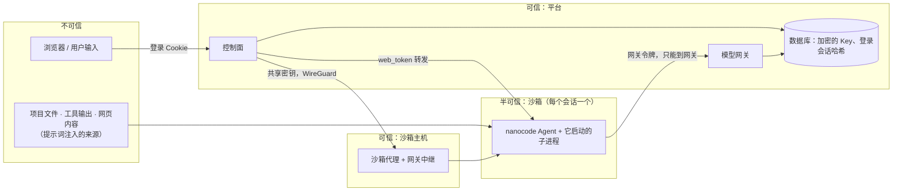

# 安全模型与信任边界

> 本文汇总 nanocode（单机）和 nanocode-server（多用户平台）**现在**的安全边界、已知弱点和在修的问题。
> 单机的攻击面和修复记录见 [README「安全」](../README.md#安全) 和 [第 04 章](04-permissions-and-hooks.md)；平台的逐项设计见 [server/README.md「几个关键的安全设计」](../server/README.md#几个关键的安全设计)。
> 发现问题请提 issue（本仓库公开：不要在 issue 里贴真实 IP、域名、密钥）。

## 一、一句话

**权限系统是启发式闸门，不是沙箱。** 真正的隔离靠容器（非 root、只读根、无 capabilities、seccomp）、网络隔离和宿主机防火墙；权限模式、allow/deny 规则、风险分类只是减少误操作和提示词注入的损失。

## 二、信任边界

| 边界 | 谁在里面 | 挡什么 | 靠什么 |
|---|---|---|---|
| 用户 ↔ 平台 | 浏览器 | 冒充他人、跨站请求、暴力登录 | GitHub OAuth + 邀请码、服务端登录会话、CSRF 检查、登录限速（[auth-and-admin.md](auth-and-admin.md)） |
| 用户 ↔ 用户 | 不同 owner 的会话 / Key / 工作区 | 越权访问 | 所有查询按 owner 过滤，别人的一律 404；每会话一个沙箱；端到端隔离测试（`demo`） |
| 沙箱 ↔ 平台 | Agent 和它的子进程 | 偷真实 Key、改模型去向、访问数据库 / 控制面 / 其它宿主机端口 | 真实 Key 只在网关；平台策略只读挂载；internal 网络 + 宿主机防火墙只放行网关（或中继）端口（#123） |
| 沙箱 ↔ 互联网 | Agent | 数据外传、下载恶意代码 | **目前没有外网**（无 DNS、无路由），这是现阶段最主要的缓解 |
| 平台 ↔ 沙箱主机 | 沙箱代理 | 远程起停任意容器、拿到 Docker API | 代理只听 WireGuard 地址、共享密钥、只暴露有限接口；Docker API 不对外（#126） |
| 单机 Agent ↔ 你的电脑 | 本地 nanocode | 误删、越界写、陌生项目配置执行命令 | 权限模式、真实路径判定、复合命令拆段、项目配置信任（`trust.py`）。**没有隔离** |

## 三、沙箱里实测到的状态

在平台的 Docker 沙箱里实测（2026-10）：

- 做得好的：非 root（uid 10001）、`CapEff=0`、`NoNewPrivs=1`、seccomp 过滤开启；根文件系统和平台策略目录只读，`/tmp` 不能执行；读不到 `/etc/shadow`；没有外网（DNS 解析失败）。
- 权限判定失败安全：deny → plan → allow → bypass → 只读 → accept_edits → ask，非交互时 ask 按 deny；路径按真实路径判定（`~`、`..`、软链接），执行前复核（#42 / PR #108）。
- 项目配置里的敏感键（hooks、MCP、`base_url`、`permissions.allow` 等）首次使用要信任确认并记内容指纹；平台策略优先级最高，读不出来就拒绝启动。
- `bypass` 模式默认不在平台允许的模式里（`NCS_SANDBOX_MODES`），`local` 启动器禁止开启。

## 四、已知弱点（open issues）

| 问题 | 影响 | 现在的缓解 | 跟踪 |
|---|---|---|---|
| 沙箱环境变量里有网关令牌 `NANOCODE_API_KEY` 和 `NANOCODE_WEB_TOKEN`，任何子进程（`env`、`/proc/self/environ`）都能读到 | 提示词注入后一条命令就能拿到。网关令牌不是真实 Key（签名、有过期、绑定会话代次、只能调平台网关），但仍能在有效期内消耗该用户的额度；web token 能驱动这个沙箱 | 沙箱没有外网；网关只在内网可达；停止 / 重启沙箱会让旧令牌失效 | [#134](https://github.com/mbaiagent/nanocode/issues/134) |
| 审计日志 `audit.jsonl` 写在沙箱数据目录，属主是 agent 用户 | 被攻陷的 agent 能改写或截断审计记录，只能作事后参考 | 无 | [#135](https://github.com/mbaiagent/nanocode/issues/135) |
| 读文件默认放行，`.env`、`*.pem`、`*.key`、`id_rsa` / `id_ed25519`、`.netrc`、`.aws/credentials` 被读时不确认 | 提示词注入可以把这些内容读进上下文 | 沙箱里没有用户的真实密钥文件（除非用户自己放进工作区） | [#136](https://github.com/mbaiagent/nanocode/issues/136) |
| 权限分类是字符串启发式：`bash -c "…"`、`xargs`、别名、变量展开看不穿；`risk.py` 只做正则识别 | 不能把 allow/deny 规则当成安全边界 | 容器隔离兜底；`review` 模式高风险永远确认 | 设计如此，见 [第 04 章](04-permissions-and-hooks.md)、[第 11 章](11-verification-loop.md) |
| 网关中继监听地址 `NCS_AGENT_RELAY_BIND` 没有拒绝 `0.0.0.0` 的校验 | 配错时中继暴露到公网 | 保持为空（默认监听沙箱网桥地址）；沙箱机防火墙 | [#129](https://github.com/mbaiagent/nanocode/issues/129) |
| `remote` 模式下平台容器仍挂载 `docker.sock` | 平台容器等于宿主机 root，没有必要 | 平台机本来就是可信组件 | [#132](https://github.com/mbaiagent/nanocode/issues/132) 第 2 点 |
| 控制面进程也持有解密用的 SecretBox | 控制面被攻破 = Key 泄露 | 威胁模型里控制面本身是可信组件 | 设计如此，见 server/README |

## 五、出站代理（计划中）与它的前置条件

用户需要沙箱里能 `pip install`、`web_search`、`web_fetch`，计划加一个**只放行 HTTP/HTTPS** 的出站代理（CONNECT 443 + HTTP 80，由代理代做 DNS，拒绝内网 / 链路本地 / 云元数据 / WireGuard 网段以及平台和宿主机地址，按沙箱限速限连接；沙箱通过 `HTTP_PROXY` / `HTTPS_PROXY` 使用，防火墙只多放行代理端口）。默认关闭。

一旦打开，"没有外网"这层缓解就没了：提示词注入只要 `env` + `curl` 就能把令牌发出去。所以：

1. **[#134](https://github.com/mbaiagent/nanocode/issues/134) 修完前不在生产打开出站代理**：沙箱里只放短期、只能访问中继的令牌，执行工具时清理子进程环境里的 `NANOCODE_*`。
2. [#135](https://github.com/mbaiagent/nanocode/issues/135)：审计由沙箱外的组件写，或实时推到平台只追加存储。
3. [#136](https://github.com/mbaiagent/nanocode/issues/136)：敏感文件读取默认 ask（非交互 deny）。

这三项和出站代理本身合并后，本节改成"已实现"。

## 六、工作区快照（计划中）的安全要求

计划把工作区打包存到 S3 兼容对象存储（B2）：对象存储凭据**只在服务器上**，不进沙箱；恢复时检查压缩包，拒绝绝对路径、`..`、指向工作区外的软链接 / 硬链接。合并后补充到本节。

## 七、运维侧的安全约定

- 本仓库公开：文档、示例、提交里只用占位符（`nanocode.example.com`、RFC 5737 的 `203.0.113.0/24` / `198.51.100.0/24`、`10.77.0.x` 隧道地址），不写真实 IP、域名、托管服务主机名 / endpoint ID、账号邮箱。
- 密钥（`NCS_SECRET_KEY`、OAuth Client Secret、`NCS_REMOTE_AGENT_SECRET`、数据库 / Redis 连接串、对象存储 Key）只放在服务器上 root 只读（`chmod 600`）的 env 文件里，不进仓库、不进聊天、不进日志、不放命令行参数（`ps` 能看到）。
- 每次重载防火墙后重跑 `deploy/firewall/check-sandbox-isolation.sh`：网关 / 中继端口 open，其它 timeout。注意 `firewall-cmd --reload` 可能清掉 fail2ban 等工具动态加的封禁规则，重载后确认它们已恢复。
- 怀疑密钥曾出现在日志或工具输出里，就轮换它（GitHub Client Secret、对象存储 Key、代理共享密钥都可以无损轮换；`NCS_SECRET_KEY` 不行，见 [auth-and-admin.md](auth-and-admin.md#六运维小抄)）。
