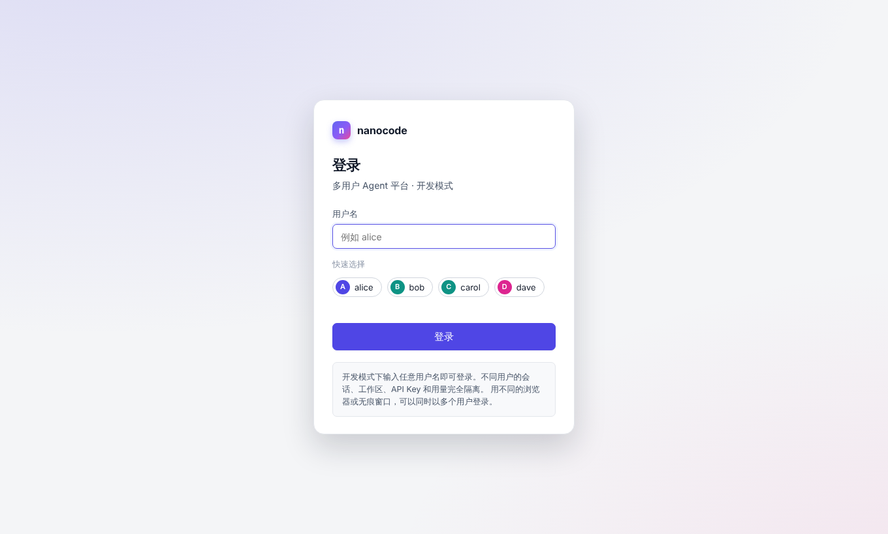

# nanocode-server：多用户 Agent 平台

把单用户的 nanocode 变成多人可用的服务。架构就是[第 12 章](../docs/12-distributed-deployment.md)的方案 A：**每个会话一个沙箱**，沙箱里跑几乎不改的 `nanocode --web`，这个包负责沙箱外面的一切：登录、会话、模型和 API Key、模型网关、沙箱调度。


## 一分钟跑起来

```bash
NCS_AUTH=dev PYTHONPATH=server:. python3 -m nanocode_server
# 打开 http://127.0.0.1:8700 ，登录页输入任意用户名
```

不需要任何 Key：内置一个演示模型。想用真实模型，在页面左下角的"模型与密钥"里添加自己的 API Key（DeepSeek、OpenAI、Anthropic、通义千问、Kimi、智谱、硅基流动、OpenRouter，或者任意 OpenAI / Anthropic 兼容的地址），每个会话都可以随时切换模型。

**多个用户**：用不同的浏览器或无痕窗口，以不同的用户名登录。每个人的会话、工作区、API Key、用量完全隔离。也可以让程序模拟：

```bash
PYTHONPATH=server:. python3 -m nanocode_server demo --users 10
```

它会让 10 个用户同时登录、各自添加 Key、新建会话、让 Agent 在工作区里写一个只有自己知道的暗号，然后逐项检查互相有没有串（看不到别人的会话和 Key、访问别人的会话被拒绝、工作区里只有自己的文件、模型收到的是自己的 Key、用量记在自己名下）。不需要真实的模型 Key。

| 登录 | 模型与密钥 |
|---|---|
|  |  |

## 组件可选：有就用，没有也能跑

| 组件 | 不配置时 | 配置后 | 怎么配置 |
|---|---|---|---|
| 数据库 | SQLite 文件（数据目录下） | PostgreSQL：控制面和网关可以多副本 | `NCS_DATABASE_URL=postgresql://...`，需要 `pip install "psycopg[binary]"` |
| 限流计数 | 进程内存 | Redis：多副本共享计数。redis-py 5.0+ 默认用 RESP2（URL 没写 protocol 时），兼容老版本 Redis（#72）；需要 RESP3 时 URL 加 `?protocol=3` | `NCS_REDIS_URL=redis://...`，需要 `pip install redis` |
| 沙箱 | `auto`：本机子进程（**没有隔离**，只适合开发） | Docker 容器 / Kubernetes Pod | 构建沙箱镜像后 `auto` 会自动用 Docker；在 K8s 集群里自动用 K8s；也可以 `NCS_LAUNCHER=local/docker/k8s` 指定；沙箱放另一台机器用 `remote` |
| 平台模型 | 只有演示模型和用户自己的 Key | 平台提供、平台付费的模型，按每人每日额度限制 | `NCS_PLATFORM_BASE_URL`、`NCS_PLATFORM_API_KEY`、`NCS_PLATFORM_MODELS` |
| 登录 | 必须显式选择。`NCS_AUTH=dev`：输入任意用户名（只允许监听本机，开发用） | `NCS_AUTH=github`：GitHub 登录 + 邀请码注册（见下文"账号与登录"）；或 `NCS_AUTH=proxy`：前面放认证代理（oauth2-proxy 等对接 SSO） | `NCS_AUTH`，github 模式另需 `NCS_GITHUB_CLIENT_ID/SECRET`、`NCS_PUBLIC_URL` |

**配了却用不了就直接报错**，不会悄悄退回内置实现（比如配了 PostgreSQL 地址但没装驱动）：否则一个以为跑在 PostgreSQL 上的集群，其实每个副本各写各的 SQLite。

用 Docker 沙箱：

```bash
docker build -f deploy/Dockerfile.sandbox -t nanocode-sandbox:latest .
NCS_AUTH=dev PYTHONPATH=server:. python3 -m nanocode_server        # auto 会检测到镜像，改用 Docker
```

Docker 沙箱：非 root、只读根文件系统、去掉全部 capabilities、禁止提权、限制 CPU / 内存 / 进程数，放在一个内部网络里——**Docker 网络出不了外网、访问不了云元数据地址，容器之间也不通**（已实测；复用已有网络时会校验 internal、关闭容器间通信、网桥名和网段，不符就拒绝启动）。internal 网络**挡不住沙箱访问宿主机网桥地址上的其它端口**（sshd、nginx……），必须在宿主机上配防火墙，只放行网关端口：见 [deploy/firewall/](../deploy/firewall/README.md)（#123）。可以用 `NCS_DOCKER_RUNTIME=runsc` 换成 gVisor。

## 架构

```
浏览器 ──▶ [认证代理] ──▶ 控制面 ───────────转发───────────▶ 会话沙箱（nanocode --web）
                         │  登录、会话、模型与 Key、调度         │  平台策略只读挂载：模型去向锁死在网关
                         │                                      │  只拿到网关令牌，没有真实 Key
                         ▼                                      ▼
                     数据库（SQLite / PostgreSQL）◀────────  模型网关 ──▶ 模型厂商
                     限流（内存 / Redis）                    按会话选 Key 和模型、限流、额度、计量
```

- **控制面**：所有浏览器请求都经过它。确认会话属于当前用户（别人的一律 404），沙箱没在运行就启动（恢复上次的对话），然后把请求和事件流转发进去。空闲的沙箱自动回收。
- **模型网关**：沙箱调用模型的唯一出口。用户的 API Key 加密保存在数据库里，运行时由网关解密并注入上游请求；沙箱拿到的是一个签名的网关令牌，网关据此查出是哪个会话、选了哪个模型、该用哪把 Key。平台模型受每人每日额度限制，用户自己的 Key 只计量不限额。注意：控制面进程也持有解密用的 SecretBox（用于启动时校验和迁移），不是只有网关能解密——威胁模型里控制面本身是可信组件。
- **沙箱**：一个会话一个，里面就是 nanocode。平台策略（`nanocode/policy.py`）锁定模型去向、限制可选的权限模式、删除能执行命令或改变请求去向的配置。换模型时重写策略并重启沙箱，对话会恢复。

### 代码结构

上层只依赖下层，每一层都可以单独测试：

```
nanocode_server/
├── __main__.py        命令行：单机 / 只启动控制面 / 只启动网关 / 多用户模拟
├── platform.py        组装：所有组件在这里创建和连接
├── config.py          配置（NCS_* 环境变量）、可选组件的选择、启动前的安全检查
├── models.py          领域对象：会话、凭证、可选模型、上游
├── web/               HTTP
│   ├── framework.py     很小的路由框架：路由、请求、响应、流式输出
│   ├── control.py       控制面接口：认证和跨站检查集中在一处，每个接口几行
│   ├── gateway.py       模型网关接口
│   └── proxy.py         转发到沙箱（含事件流）
├── services/          业务（不知道 HTTP）
│   ├── catalog.py       模型目录：演示 / 平台 / 用户自己的 Key；添加 Key 的校验
│   ├── sessions.py      会话生命周期：创建、启动、换模型、停止、回收
│   └── upstream.py      访问模型厂商：地址安全检查（防 SSRF）、流式读取、用量计量
├── runtime/           沙箱启动器：local / docker / kubernetes，同一个接口
├── storage/           SQL 存储（SQLite 和 PostgreSQL 同一套代码）、限流（内存 / Redis）
├── security/          签名令牌、API Key 加密、身份认证
├── demo.py            多用户模拟（含一个假的 OpenAI 兼容模型）
└── static/            页面：登录、主界面（会话列表 + 对话 + 模型与密钥）
```

### 几个关键的安全设计

| 风险 | 做法 |
|---|---|
| 沙箱里的 Agent 读到真实 Key 并外传 | 真实 Key 只在网关；沙箱只有网关令牌（HMAC 签名、有过期时间、只能调网关） |
| Agent 改沙箱里的配置，把请求发到别处 | 平台策略只读挂载，优先级最高；网关还会按会话强制模型 |
| 用户把自己的 Key 指向内网地址（SSRF） | 默认只允许 https 公网地址并固定已检查的解析 IP；`NCS_ALLOW_PRIVATE_UPSTREAMS=1` 仅限本机 `dev` 模式，仍拒绝链路本地、组播和保留地址；公网地址只能走 https，本机或 RFC1918 / ULA 私网地址可用 http |
| 数据库泄露 | 用户的 Key 加密保存（HMAC-SHA256 流加密 + 认证标签，只用标准库） |
| 访问别人的会话、Key | 一律按"不存在"处理；有专门的端到端测试 |
| 绕过认证代理伪造身份 | 代理必须带共享密钥；没配密钥拒绝启动 |
| 开发模式被恶意网页利用（DNS 重绑定） | 开发模式只接受 Host 为本机地址的请求 |
| 跨站请求伪造 | 写接口只收 JSON；带 Origin 的请求必须来自本站；登录 Cookie 是 HttpOnly + SameSite=Lax，https 下加 Secure 和 `__Host-` 前缀；OAuth 回调校验 state（放在短命签名 Cookie 里）并用 PKCE |
| 登录会话被盗用 / 无法吊销 | 服务端保存登录会话（不是 JWT），库里只存令牌的 SHA-256；退出、停用账号立即失效；有绝对和闲置两个有效期 |
| 暴力尝试邀请码 / 刷登录 | 每个 IP 每分钟限 `NCS_LOGIN_PER_MINUTE` 次（多副本时用 Redis 计数）；邀请码约 64 位随机、只存哈希 |
| 多个控制面副本同时启动同一个会话 | 数据库里原子地"抢占启动"，只有抢到的那个去启动 |

## 测试

```bash
python3 -m unittest discover -s server/tests
```

可选组件的测试默认跳过，配了才跑：

```bash
NCS_TEST_DATABASE_URL=postgresql://postgres@127.0.0.1:5432/ncs \
NCS_TEST_REDIS_URL=redis://127.0.0.1:6379/0 \
NCS_TEST_DOCKER=1 \
python3 -m unittest discover -s server/tests
```

覆盖：令牌、加密、认证；SQLite 和 PostgreSQL 上同一套存储测试（含多线程抢占启动）；内存和 Redis 限流；模型目录和 SSRF 检查；网关（按会话选 Key、计量、额度、限流、错误透传、HTTP/1.1 分块编码）；K8s 启动器（假的 API 服务器）、Docker 启动器（真的启动容器）；平台端到端（登录、多用户隔离、换模型后对话保留并经网关调用、停止和恢复、容量、回收、代理认证）；部署清单和代码的一致性。

## 压测

```bash
python3 -m nanocode_server loadtest --users 10 25 50 100   # 本机 Docker 沙箱，每档同时开会话
```

每档报告登录、添加 Key、建会话、发消息、等结束各步的 p50 / p95 / 最大值，以及沙箱同时运行时的内存。结果和分析见
[verification/results/perf-loadtest.md](../verification/results/perf-loadtest.md)。
在 100 个用户同时开会话的测试中全部成功；建会话的延迟随并发线性增长（约每 1 个沙箱 0.24 秒），是现在最明显的瓶颈。

## 账号与登录（NCS_AUTH=github）

- **登录**：只用 GitHub OAuth，申请 `read:user user:email`，不读用户仓库；access_token 用完即丢。账号按 GitHub **数字 id** 绑定（login 改名不影响），id 形如 `gh-14838384`，就是会话、Key、用量表里的 owner。
- **注册**：第一次登录必须带有效邀请码（登录页填写）；`NCS_ADMIN_GITHUB_LOGINS` 里的 login 例外，直接成为管理员。如果名单里的 login 已经被另一个 GitHub 账号用过（原主人改名、别人抢注），不会给管理员；更稳的写法是 `id:<数字 id>`。
- **管理员**：`/admin` 页面（或 `/api/admin/*`）生成、查看、撤销邀请码（可设次数、有效天数，明文只显示一次），查看账号、停用 / 启用账号（停用立即作废登录会话并停掉运行中的沙箱）。
- **老数据**：schema v2 把之前 dev / proxy 模式下出现过的用户名（owner 字符串）回填成 `legacy` 账号，会话、Key、用量原样保留。它们和 GitHub 账号不会自动合并（自动按名字合并有冒领风险）。
- 创建 GitHub OAuth App：GitHub → Settings → Developer settings → OAuth Apps → New OAuth App，Homepage URL 填 `NCS_PUBLIC_URL`，Authorization callback URL 填 `<NCS_PUBLIC_URL>/auth/github/callback`。

## 单机部署（docker compose）

一台 Linux 服务器给一个团队用：`deploy/compose/` 起控制面 + 模型网关（一个进程）、PostgreSQL 16 和 Redis 7，沙箱用宿主机 Docker（每个会话一个容器，内部网络、非 root、只读根文件系统）。步骤、限制和 GitHub 登录（P1）还没做时的访问方式见 [deploy/compose/README.md](../deploy/compose/README.md)。

## 生产部署（Kubernetes）

清单在 [`deploy/k8s/`](../deploy/k8s/)，镜像在 [`deploy/`](../deploy/)：

1. 构建并推送两个镜像：`deploy/Dockerfile.sandbox`（沙箱）、`deploy/Dockerfile.server`（控制面和网关共用）；
2. 节点装好 gVisor（`runsc`），网络插件支持 NetworkPolicy；
3. 准备 PostgreSQL 和 Redis（建议用托管服务；`45-postgres-redis.example.yaml` 是集群内的示例）；
4. 按 `40-secrets.example.yaml` 创建密钥；
5. 改 `50-control-plane.yaml`、`60-gateway.yaml` 里的镜像、平台模型、额度；按你的 SSO 改 `70-oauth2-proxy-ingress.example.yaml`；
6. `kubectl apply -f deploy/k8s/`。

配了 PostgreSQL（共享数据库）和 Redis（共享限流计数）后，控制面和网关都可以多副本横向扩展。没配这两个时，状态在进程内存和本地 SQLite 里，多副本之间不共享，会出现会话/计数不一致。每个会话的平台策略由控制面创建成独立的 ConfigMap。

## 配置

| 变量 | 说明 | 默认 |
|---|---|---|
| `NCS_SECRET_KEY` | 主密钥：签名令牌、加密用户的 Key。控制面和网关必须相同。开发模式不配会自动生成并保存在数据目录 | 生产必填 |
| `NCS_DATA_DIR` | 数据目录（SQLite、本机 / Docker 沙箱的工作区） | `./ncs-data` |
| `NCS_DATABASE_URL` / `NCS_REDIS_URL` | 见上表 | 空 |
| `NCS_REPLICAS` | 副本数。大于 1 时必须配 PostgreSQL 和 Redis，否则拒绝启动（SQLite 多副本会脑裂，#72） | `1` |
| `NCS_HOST` / `NCS_PORT` | 控制面监听地址 | `127.0.0.1` / `8700` |
| `NCS_AUTH` | `github`（GitHub 登录，生产）/ `proxy`（认证代理）/ `dev`（登录页任意用户名，只限本机） | 无，必须设置 |
| `NCS_GITHUB_CLIENT_ID` / `NCS_GITHUB_CLIENT_SECRET` | GitHub OAuth App 的 Client ID / Secret（github 模式必填） | — |
| `NCS_ADMIN_GITHUB_LOGINS` | 引导管理员：这些 GitHub login（或 `id:<数字 id>`）第一次登录不需要邀请码，并成为管理员。逗号分隔 | — |
| `NCS_SESSION_TTL` / `NCS_SESSION_IDLE` | 登录会话的绝对有效期 / 闲置有效期（秒） | 30 天 / 7 天 |
| `NCS_LOGIN_PER_MINUTE` | 每个 IP 每分钟最多发起几次 GitHub 登录 | `10` |
| `NCS_TRUST_FORWARDED` | 前面有反向代理时用 `X-Forwarded-For` 最后一项作客户端 IP（限流用）；没有代理时别开，否则可伪造 | `false` |
| `NCS_GITHUB_OAUTH_URL` / `NCS_GITHUB_API_URL` | GitHub 地址，只在测试 / 冒烟时改成假的 GitHub（必须 https，本机地址除外） | `https://github.com` / `https://api.github.com` |
| `NCS_AUTH_HEADER` / `NCS_PROXY_SECRET` | 代理模式：身份请求头 / 共享密钥 | `X-Auth-Request-Email` / — |
| `NCS_PUBLIC_URL` | 对外地址：https 时 Cookie 加 Secure；github 模式下 OAuth 回调地址是 `<它>/auth/github/callback`，必须 https（本机地址除外） | — |
| `NCS_LAUNCHER` | `auto` / `local` / `docker` / `k8s` / `remote`（沙箱在另一台机器，见 deploy/sandbox-host/） | `auto` |
| `NCS_SANDBOX_IMAGE` | Docker 和 K8s 用的沙箱镜像 | `nanocode-sandbox:latest` |
| `NCS_SANDBOX_MODES` / `NCS_SANDBOX_MODE` | 沙箱里允许的权限模式 / 启动模式；本机启动器不允许 `bypass` | 除 bypass 外全部 / `default` |
| `NCS_SANDBOX_MCP_SERVERS` | 给每个沙箱配的 MCP 服务器，JSON 对象（格式同 settings.json 的 `mcpServers`）或 JSON 文件路径。用户和项目自己配的 MCP 服务器一律不生效（能执行命令）；命令要在沙箱镜像里存在，Docker / K8s 沙箱没有外网 | 空 |
| `NCS_SANDBOX_CPU` / `NCS_SANDBOX_MEMORY` | 每个沙箱的资源上限 | `1` / `2Gi` |
| `NCS_DOCKER_RUNTIME` / `NCS_DOCKER_NETWORK` | Docker 运行时（如 `runsc`）/ 沙箱网络名 | — / `ncs-sandboxes` |
| `NCS_DOCKER_BRIDGE` / `NCS_DOCKER_SUBNET` | 沙箱网桥网卡名 / 沙箱网段（宿主机防火墙按它们写规则，见 deploy/firewall/；空 = Docker 自动分配） | `ncs-sbx0` / `172.30.250.0/24` |
| `NCS_SANDBOX_TMPFS` / `NCS_SANDBOX_PIDS` | Docker 沙箱 /tmp 大小（算在沙箱内存里）/ 进程数上限（#119）；大小也认 `384m`、`1g` 写法 | 512m 与内存一半取小 / `512` |
| `NCS_REMOTE_AGENT_URL` / `NCS_REMOTE_AGENT_SECRET` | `NCS_LAUNCHER=remote`：沙箱代理地址（走 WireGuard）/ 两边共用的密钥（≥32 字符），见 [deploy/sandbox-host/](../deploy/sandbox-host/README.md) | — |
| `NCS_REMOTE_GATEWAY_URL` | 远程沙箱访问网关的地址（沙箱主机上的中继）；空 = 启动时问代理 | — |
| `NCS_AGENT_BIND` / `NCS_AGENT_UPSTREAM_GATEWAY` / `NCS_AGENT_RELAY_BIND` | 沙箱代理（`python -m nanocode_server sandbox-agent`）：监听的隧道地址（不能是 0.0.0.0）/ 平台的网关 / 中继监听地址（空 = 沙箱网桥） | — |
| `NCS_AGENT_RELAY_MAX_CONNECTIONS` / `NCS_AGENT_RELAY_PER_SANDBOX` / `NCS_AGENT_RELAY_IDLE_TIMEOUT` | 沙箱代理的网关中继：全局连接上限 / 每个沙箱上限 / 空闲断开秒数 | `128` / `16` / `300` |
| `NCS_K8S_*` | 命名空间、运行时类、存储类、工作区大小、API 地址 | 见 `config.py` |
| `NCS_MAX_SANDBOXES` / `NCS_MAX_SESSIONS_PER_USER` | 总容量 / 每人同时运行的会话数 | 200 / 3 |
| `NCS_IDLE_TIMEOUT` / `NCS_TOKEN_TTL` | 空闲回收秒数 / 网关令牌有效期（也是沙箱最长存活时间） | 1800 / 43200 |
| `NCS_REAP_INTERVAL` | 回收线程多久醒一次（秒）。没有运行中的沙箱、或最早的回收时间还没到时醒了也不查数据库，托管 Postgres 能缩到零（#131）；多副本时每次都查 | 60 |
| `NCS_GATEWAY_HOST` / `NCS_GATEWAY_PORT` / `NCS_GATEWAY_URL` | 网关监听地址 / 端口 / 沙箱访问网关的地址（单独部署时必填） | `127.0.0.1` / `8701` / — |
| `NCS_PLATFORM_BASE_URL` / `NCS_PLATFORM_API_KEY` / `NCS_PLATFORM_PROTOCOL` / `NCS_PLATFORM_MODELS` / `NCS_PLATFORM_LABEL` | 平台提供的模型 | — / — / `openai` / — / `平台模型` |
| `NCS_ENABLE_MOCK_MODEL` | 提供演示模型 | `true` |
| `NCS_ALLOW_PRIVATE_UPSTREAMS` | 允许 dev 模式下用户的 Key 指向内网 / 本机（如本机 Ollama）；与代理认证模式互斥 | `false` |
| `NCS_DAILY_TOKENS` / `NCS_RPM` / `NCS_MAX_OUTPUT_TOKENS` | 每人每日平台模型 token 上限 / 每分钟请求上限 / 单次输出上限 | 2000000 / 30 / 8192 |

## 局限（如实说明）

- **K8s 清单没有在真实集群里跑过**：YAML 和代码的一致性有测试，Pod 创建流程用假的 API 服务器测过；gVisor、NetworkPolicy、oauth2-proxy 的实际效果需要在你的集群里验证。单机上的 Docker、PostgreSQL、Redis 都实测过。
- 容量满时直接拒绝，没有排队。
- 审计日志写在沙箱里，Agent 能改，还不能当作可信审计。
- 没有指标、链路追踪和告警，没有压测数据，没有计费和管理后台。
- Docker 沙箱的网络隔离依赖 Docker 的内部网络，没有像 NetworkPolicy 那样按端口精细控制；Docker 沙箱默认也装不了依赖（出不了外网），需要的话给沙箱网络加一个包镜像代理。
